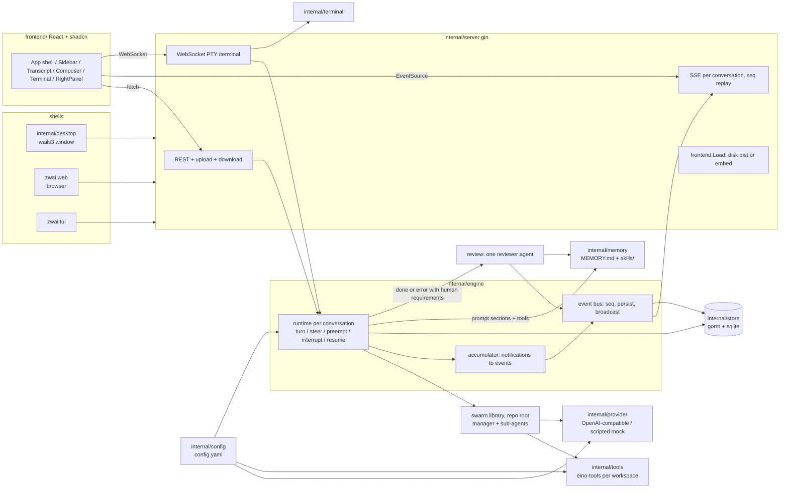
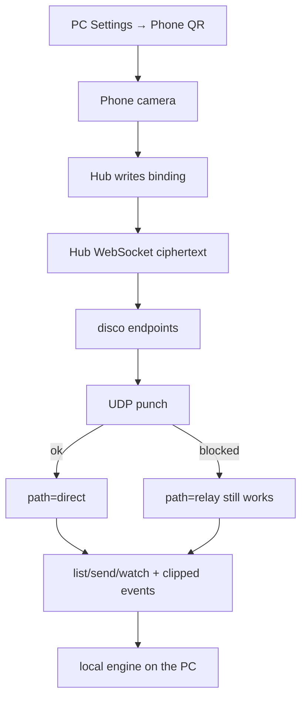

# Architecture

One data directory has one engine process. That process holds the config, the
SQLite database, the model pool, the per-conversation runtime and the HTTP
server. Desktop, the browser and the terminal are clients of it. The first
shell starts `zwai engine` (its own session, so closing the shell does not
hang it up). A later shell of the same build attaches. A different version,
or a binary whose file identity is not the one `engine.json` published,
requests an automatic, bounded handoff from the old engine, stops it and
starts its replacement listener within a 30-second handoff/listen target after
checkout frontend preparation. The old engine
freezes new work, checkpoints every active or parked registry, gives workers
a shared opportunity to summarize, and preserves uncertain tool effects for
verification after recovery. It never treats a handoff summary as completion. Clients attach over loopback HTTP: they list, watch, send,
steer, interrupt and answer. They do not open the database. Closing a window
or leaving the terminal only drops that client's presence connection. The
engine exits after the idle grace once no presence connection is held, the
phone hub socket is down, and no turn is running. A host that is killed
releases `engine.lock`; the next shell takes it and resumes orphaned turns.

Runtime transcript inputs carry explicit provenance: ADK `Extra["zwai_message_source"]` and persisted `messages.source` distinguish `human`, transient `runtime`, `schedule`, and `plan`. Runtime correction cues remain available during their turn and in diagnostics, but future replay, compact summarizer input and session briefing extraction exclude them. Legacy cue compatibility matches complete constants or a validated worker-ID suffix, then preserves any independently evidenced human input. It never classifies similar prose as a correction.

Goal and plan commands retain their complete argument through one engine
dispatch. An idle PC composer submits the complete command through the existing
send path; it does not first PATCH metadata and then resubmit the parsed
argument. Leading commands own suffix command tokens inside their arguments.
The store carries command intent through send: commands cannot become answers or
queued prose. Goals use the existing steer endpoint; plan entry uses start-turn
admission so a newly busy target refuses it. Busy goal updates and bare planning
keep their existing metadata operations.

Explicitly queued human follow-ups start in FIFO order after a turn completes
or fails, independently of automatic goal continuation. A failed scheduled check
keeps its failed turn/run and future wake; no queue means no new error-triggered
turn. Stop, cancellation and restart do not auto-drain the queue. Terminal writes
and finalization release their ownership before the next turn starts.

Queued-message consumption is claimed by successful row removal: concurrent
automatic dequeue and manual steering cannot both deliver the same row or
discard a concurrent edit. PC queue actions coalesce pending clicks per
conversation/row and ignore another conversation's late response. Missing-record
HTTP responses carry a request ID and matching safe WARN log
(`internal/server/missing_record.go`); they do not terminate the model turn.

The launcher prepares the checkout frontend before discovering or handing off
an existing engine, while that engine continues serving. A preparation failure
or cancellation returns before replacement begins. This catches build failures
available at preparation time; the new process still validates its own startup.
After engine handoff freezes execution, a checkpoint storage failure instead
retains the freeze and captured checkpoints. Readable history, Trace and failed
restart status remain available; repairing storage allows retrying the handoff
without automatically executing unknown external operations.

When a bundle needs rebuilding, `frontend/ensure.go` checks `package.json`'s
direct dependencies and devDependencies through installed package manifests
and declared local executable entries. Missing packages or build tools trigger
`npm install --include=dev`, followed by another readiness check before build
and source-stamp publication. `frontend/ensure_build_lock.go` serializes
installation/build/stamping across processes using the checkout's ignored
`.build-lock` directory, rechecks staleness after locking and permits cancelling
a waiter. A build command owns its process tree: cancellation or script exit
stops and waits for its descendants before the checkout lock can be reused.
Unix uses a process group; Windows uses a Job Object. A fresh bundle or installed
embed does not acquire a new Node dependency.

After preparation, `cmd/zwai/engine_boot.go` waits up to two minutes for cold-start
local readiness, reporting every ten seconds. ACK and stopping the old process
make replacement irreversible: the launcher then uses the cancellable launch
owner instead of killing the only replacement at the handoff deadline. A live
child that exceeds the cold wait remains running and yields its PID/log path
with an ownership-unconfirmed pending error. This proves only that this launch's
child has not exited: a busy lock may belong to a competitor, and a free lock
does not prove the child cannot acquire it later. Successful metadata validation
is still required before attaching. Explicit cancellation reaps only this
launcher's child; a competing loser is reaped when its single Acquire fails.

`app.New(DeferRestore:true)` constructs the engine and routes without recovering
history. `serveEngine` listens, publishes a `restoring` lease and serves HTTP,
then owns synchronous `App.Restore`; the idle watcher counts recovery as active
work. `Engine.Restore` builds one indexed checkpoint/event snapshot per conversation,
passes it through the restored runtime bootstrap, including the validated identity
of an unanswered human call and both manager correction
allowances, and records `engine_restore` measurements on the original turn. The
filtered events retain `model_retry` and `max_iterations_continued` receipts across
checkpoints. A new human cap continuation discards the startup snapshot before
reading its new durable allowance receipt; later work does not reuse that snapshot. Running and parked recovery failures are
aggregated as `RestoreFailures`, with failed Trace receipts and `restore.failed`;
other conversations continue. The compatibility `ResumeOrphanedTurns` entry
returns accepted resumptions together with the same typed aggregate, preserving
per-conversation causes. Stop is serialized with each conversation's
restoration. Only after recovery finishes does the scheduler start and metadata
become `ready`. PC and phone show progress; work mutations are gated on both
HTTP and encrypted RPC while reads, drafts, presence and Stop remain available.
Shutdown cancels recovery and waits before closing its store.

A desktop launcher acknowledges a real presence SSE before returning the
window URL, and owns that connection until shutdown, including page reloads.
The URL carries its initial presence id so the frontend does not add a second
desktop client. If that stream drops, the native owner makes at most three
reserve/acknowledge attempts on the same URL, with cancelable handshakes and
backoff inside the idle grace. A hold stable for an idle grace renews this
budget; repeated short acknowledged streams do not. Only the handshake has a
deadline. After ApplicationStarted, exhaustion synchronously records the cause
through the configured desktop logger before queueing Wails Quit. AppKit may
terminate without returning to Go, so reporting cannot depend on Run returning.
Returning platforms retain the typed cause; an early failure returns without
opening a window. Neither path ensures another engine or changes the window URL.
Final idle shutdown rechecks `Engine.ActiveWork`, including parked workers
and restart ownership, under the presence admission lock: a new hold
either prevents the exit or receives `503 engine_stopping`. A launcher retries
only after the original holder is observed gone or its recorded process/start/build
identity changes, even when the replacement reuses the URL. The launcher keeps
the validated record through the handshake, then repeats the complete identity/lease
check within a bounded wait; it never kills an unhealthy holder.

Desktop update installation is also locked by the actual app bundle across
engines with different data directories. The stable filesystem lock covers
download, replacement and native launch/rollback; a successful installation
keeps it until the old engine exits. Old-bundle cleanup owns a unique backup,
so a later installer cannot lose its rollback copy. `POST /api/update` remains
the installation result; while it is pending, the frontend polls the read-only
`GET /api/update/progress` snapshot for downloaded bytes and installation stage.
An unavailable progress read leaves the installation running. A failed install
retains its confirmed version for a direct retry.

Both graphical shells load the **same** `http://127.0.0.1` origin, so there
is exactly one implementation of uploads, downloads and the live event stream.
Traffic lights follow the window (`?shell=desktop` or the native bridge), not
the server mode string, because that mode is `engine` for every client.

The renderer health nonce remains painted inside the macOS WebView. A small
opaque native sibling covers that corner on screen and stays outside
`WKWebView.takeSnapshot`; only those underlying pixels can acknowledge a paint
challenge. Background sampling precedes the first probe and follows theme and
dialog changes through a bounded same-origin message, independently of health
and recovery budgets. A later decoration failure preserves the existing cover
and continues real pixel checks.



## Manager scheduling reports

Manager prose admission for scheduled-work claims lives in
`internal/engine/schedule_answer.go` and `manager_answer_buffer.go`. A tool-free
policy call classifies candidate assertions by stance, time and attribution.
Only affirmed, current, assistant-owned assertions enter schedule verification;
denials, status-only reports, relayed human prohibitions and ended/cancelled
historical waits do not assert an armed wait. Quotes retain their contiguous
semantic context rather than isolating an affirmative fragment. Missing or
invalid classification fields retry the original candidate as malformed output.
The classifier still interprets prose; these structural checks do not prove
an external model's semantic accuracy. Code checks eligible claims against
persisted schedule rows, current state and turn ownership before publishing
the buffered text. `schedule_answer_pending.go` first stores the candidate's
original identity, pending events, final answer and transcript in the private
`pending_schedule_answers` table. Its transaction-assigned per-turn ordinal
defines candidate order independently of wall time. A newly saved answer
keeps only its latest full transcript, compacting prior answer payloads in the
same transaction. Deferred answers retain their unpublished content with only
the old transcript removed; distinct report receipts remain until the turn finishes.
Classification requests use `provider.WithIsolatedRecovery`: they neither
wait for nor update the shared origin gate, emit provider cooldown observations,
or receive the HTTP adapter's implicit header-timeout reconnect. Each request
still uses the complete configured response-header and body-idle budgets,
without an extra total deadline. Request failures (`classification_unavailable`)
and malformed output (`classification_invalid`) retry only the original
candidate with persistent 5/10/20/30-second capped delay. Malformed output resets
the separate consecutive request-failure counter. Local storage/configuration
failures have distinct codes and do not consume that counter.

After three consecutive classification request failures, the candidate becomes
`deferred` durably and its unpublished text remains private. This decision does
not establish a false schedule claim or consume its correction allowance.
The same turn, Registry and workers keep their identities: an executable goal
or active same-thread wake permits the next manager work slice with real tool
receipts, while an ordinary turn uses the existing human Continue/Stop pause.
The old candidate is not retried or published. Stop cancels a request or wait;
a human steer supersedes the unpublished candidate and continues with actual
receipts. The failure limit is an internal policy constant, not a new setting.

A confirmed unsupported scheduling claim still gets one correction in the
same turn. Its durable `model_retry` receipt preserves that allowance across
restart; another unsupported claim fails explicitly. Removing the claim lets
the corrected answer publish. A `no_matching_schedule` terminal error does not
mark a standing objective externally blocked or overwrite its block reason.
Automatic goal continuation retains its existing budget and stops after three
consecutive same-objective ordinary-pursuit failures of this class, with a distinct durable
`goal_capped` reason instead of `goal_blocked`. This goal-level cap is separate
from each turn's one correction and survives engine replacement. Before a cap,
success, cancellation, another error class or a new human turn during unpaused
pursuit breaks the streak. Once capped, ordinary PC/phone sends answer only their
current request, retaining the pause, automatic-turn count and original failure
diagnostic. Explicit Start / HTTP `goal_resume: true` / phone `resume_goal`
resumes pursuit and resets its budgets; setting/clearing the goal also resets the
failure budget. Manager reopen does not. Failed scheduled checks retain their future-wake ownership instead
of immediately starting another goal turn. `internal/store/goal_cap.go` commits
the cap and reason event atomically after rechecking the goal, automatic count
and latest turn. Unknown budget evidence pauses with a distinct recovery-state
reason; failed persistence never grants another automatic attempt.
The retry notice records the completed correction request; a terminal refusal
has its own row and no longer reads as an active verification wait.
Unreadable private state, correction receipts or failed storage writes also fail explicitly instead of
pretending recovery is durable. `model_backoff` and classifier LLM records
belong to the original turn's Trace; private candidate prose is not a public
event, ordinary history or compaction input.

`report_admission.go` commits the requested scheduling action and saves its
private findings plus original tool-call receipt before returning
`report_pending:true`. Verification then runs outside the global goal/wake
lock. Restoring that saved receipt settles the original call without executing
its scheduling action again. The action and private save are separate commits:
if saving fails after a change, the tool returns `answer_storage_failed` with
`action_committed:true` and `report_published:false`, retaining a schedule ID
when available. A crash between those commits has unknown effect and requires
checking current state before retrying the action. This is not an all-window
exactly-once guarantee. `schedule_answer_restore.go` reads the latest
answer's decision and restores its workers before deciding whether the manager
may run; a rejected latest candidate cannot revive an older answer. Recovery
first verifies an eligible pending candidate. A deferred candidate cannot
reclaim execution or replace a newer checkpoint with its old transcript.
Legacy retry state derives its consecutive failure budget only from a
contiguous suffix of that candidate's durable classification receipts; origin
waits and missing attempts cannot prove the budget. Admission atomically writes
public events, replay messages and the accepted candidate state, so an already
accepted candidate is not broadcast again. Thread/project deletion and rewind
remove private candidates in the same transaction as their owners. A terminal
turn commit clears its candidate payloads and retains lightweight decision
receipts; a failed commit preserves the full recovery payload. A private
candidate alone does not fabricate a planned-handoff checkpoint. Public
handoff checkpoints serialize a copy of manager history with pending prose
removed, including provider-owned Responses text. Accepted history, tool calls
and reasoning remain; filtering does not mutate the original private history.

## Ordinary turn completion

`internal/engine/worker_completion.go` checks delegated work before admitted
completion prose is published. `Registry.PendingAgents` includes both running
workers and finished results that the manager has not collected. Actual
`wait_agents` results and explicit `close_agent` decisions settle the exact
worker generation; a timed-out wait or an old generation's result cannot settle
a later resume. Closing finished work acknowledges discarding its result and
retains `already_finished`, rather than reporting a new cancellation.
The gate applies to a manager's natural completion. Exhausting a ReAct slice
is not that attempt; resource limits and externally completed or blocked goals
retain their existing termination boundary rather than gaining a collection pause.
Human preemption and existing scheduled-check completion eligibility precede
collection admission. An empty failed check keeps its original error/ownership
semantics and cannot be converted into a worker-collection pause.

Without a currently executable goal or active same-thread wake, an early final
is withheld and receives one same-turn correction with the original worker IDs.
`model_retry` reason `workers_uncollected` durably records the consumed allowance
and IDs in the original Trace. A second early final uses the existing human
Continue/Stop pause while the turn and worker requests remain live. Continue
allows one further attempt; Stop or declining cancels. Checkpoints and event
replay retain collection state, the allowance and an existing human pause across
restart. Legacy finished rosters without generation identity remain historically
finished; legacy running work still requires collection. Ownership is reread
after scheduling policy verification, so removing
the last owner during that request cannot authorize stale parking. This fresh
check is the completion-gate decision point: an owner present then permits
yielding; later explicit revocation retains the existing worker cancellation
and finalization boundary, without rolling back published prose. Valid goal
and wake parking continues under the existing ownership rules.

## Composer durability and renderer recovery

The engine owns `composer_drafts` and scoped `composer_draft_blobs`. A browser
origin is not a persistence identity: restarting the engine may change its
loopback port. A snapshot transaction saves text, quotations, attachment metadata
and new original bytes under `thread:<id>`, `new:<project-id>` or `new:home`.
Revision CAS and versioned empty tombstones reject delayed writes from an old
page. Existing immutable attachment IDs avoid copying large files on each
keystroke. Sending freezes the target, flushes the draft and records `sending`;
only a server acknowledgement clears that version. Lost acknowledgements retain
an uncertain snapshot, with no automatic retransmission. First-send migration
retains the source until acknowledgement so an older native context remains safe.
An inactive session releases its saved attachment cache and preview URLs when no
subscriber, operation or pending write owns it; returning reloads the original
bytes from SQLite. Dirty, conflicted and sending sessions retain their ownership.

`internal/desktop/recovery*.go` runs outside WebContent. A same-origin main-frame
challenge must produce its complete ordered 64-bit pixel pattern in a public WKWebView
snapshot. JavaScript progress alone does not prove that the GPU painted. A
deadline first requests one reload, then invokes the launcher's attach-only
successor path. `cmd/zwai/desktop_recovery_darwin.go` holds engine presence,
checks the original lease identity and launches a private immutable app copy.
The inherited pipes carry the cumulative attempt budget and require ready,
commit and committed before the old window quits. After sending the private
handoff, the parent observes its exact child's native registration within the
same deadline. On the native main thread it rechecks the child's kernel birth
and executable identity, its own foreground window and cancellation before one
activation request. On macOS 14 and later the parent yields activation to that
child before requesting cooperative activation; older systems use the parent's
targeted activation request. User app switches, hidden/minimized windows and
cancellation prevent the request. Focus observation is cancelled and joined
on genuine pixel readiness, child exit or caller cancellation; it does not
acknowledge health or extend
the deadline. Bounded native guard and activation diagnostics neither add
journal phases nor establish that the OS actually activated the window. An
observation error records a safe warning while the original Ready/exit/context
protocol determines the outcome; it cannot replace a user close with retry.
This follows Apple's [cooperative activation model](https://developer.apple.com/documentation/appkit/passing-control-from-one-app-to-another-with-cooperative-activation?language=objc):
the active parent grants permission before requesting activation on the child's
behalf; the system still decides whether to honor it.
The replacement preserves
engine, turn and worker identities; it cannot perform engine handoff or restart
task work. Sleep/focus changes reset observation grace, not the failure budget.
Normal exit does not restart the shell. Local diagnostic journals are bounded;
attributed recovery events enter the existing one-turn Trace path.

Before an automatic reload/replacement, the controller reports its last probe
boundary and age using the same diagnostic path. This adds no per-probe journal
stream or recovery delay. Callback absence is distinct from a pending snapshot,
capture error and mismatched pixels. Lease failures keep `ErrUnreachable` while
exposing only safe HTTP categories, status and elapsed time; parent prelaunch,
successor attach and post-ready precommit validation have separate error prefixes.
The existing asynchronous reporter does not guarantee that enqueueing has become
durable before reload. Neither a lease error nor a missing callback identifies
the renderer's root cause.

Location attribution is separate from the paint probe. After publishing
`window.__zwaiRecoveryAttribution`, `installComposerRecoveryAttribution` emits
`zwai:recovery-location` synchronously when its thread/turn/project/draft-key tuple
changes. The event carries no content or detail payload. Draft save/revision
changes keep the global attribution current without emitting another location
event. The native-injected bridge reads the current tuple on installation and
on subsequent events, binds it to its session/generation, and replaces its old
listener when that identity changes. Native validation also requires the
current window and same-origin main frame; no draft text or attachment crosses
this bridge.

An active thread owns its route through thread ID and draft key. Its project is
derived only from that thread's metadata; a loose or not-yet-listed thread never
inherits the sidebar's previous selected project while detail loads. Only a new
conversation without an active thread uses the selected project.

Document identity is also explicit. Native increments an internal document epoch
before requesting Reload. The first same-origin probe in a JS world pins its
session/generation/document stamp before checking whether the root has mounted.
A later probe with a new epoch cannot rebind that old world within the same
session/generation; only the new document's new global can claim the new epoch.
Native rejects queued location messages carrying the old epoch. Changing the URL
or matching its recovery query is not proof that a new document was created.

`internal/desktop/recovery_location.go` retains that independent location rather
than letting an older paint response overwrite it. One native `SetURL` reload
updates only the recovery-scope query fields on the original URL, preserving
the origin, PID/presence and other query fields and fragment. An explicit
initial/reload recovery scope remains expected until the page publishes its
matching selection; bootstrap Home or another scope cannot replace it. Once
matched, deliberate user navigation to Home is valid again. Matching invalidates
any previous challenge/capture and requires fresh challenge pixels. Location
notifications neither acknowledge health nor renew startup, reload or replacement
deadlines. Browser URL-routing and injected-script tests exercise these boundaries;
they do not accept the formal installer's native fault recovery (Issue #110).
The reporter accepts a bounded queue without blocking the health controller.
Closing it excludes late producers, cancels the in-flight HTTP request and
drains already accepted rows locally without starting more Trace requests.

Checkout re-exec bundles live under
`~/Library/Caches/zwai/bundles/<executable-sha256>/zwai.app`. Per-hash locking,
temporary construction and atomic publication prevent another `go run` from
overwriting or re-signing an executable already used by an engine/window.

## Phone remote (pairlink)

The PC stays the system of record. A phone never hits gin `/api`. Binding is a
QR; the current phone client uses the hub WebSocket relay. Pairlink can also
support UDP with compatible peers. The hub sees
fingerprints and ciphertext length, not projects or events. The desktop host
must keep a live WebSocket on the hub (keepalive data frames, reconnect on
drop). The phone does the same on its ticket socket (a quiet hub drops after
60s). A drop paints a reconnect banner and retries the saved ticket — it
does not unlink. Pairing HTTP can succeed with a dead socket; redeem then
returns `host offline`. `GET /api/remote/status` `online` follows that socket. While the pairing QR is on screen, Settings → Phone re-reads `GET /api/remote/bindings` about once a second so a new phone shows up without leaving the page; a failed read leaves the list already painted. While pairing is on
and `remote.keep_awake` is on (the default), `internal/wakeup` holds a
system sleep assertion (`awake` on that same status). The assertion
follows the config, not the socket: a hub reload must not release and
re-acquire or idle sleep wins the gap. On macOS the hold is AC-only.

`internal/remote/host_start.go` owns the cancellable background registration
lifecycle started by `Host.StartBackground`; hub registration is not a local
HTTP readiness condition. A slow or unavailable hub leaves desktop, browser
and terminal startup available while the phone reports its connection state.
Stop and Reload cancel pending registration; late results cannot install a
host after its lifecycle has ended.

`host_links.go` owns the connected lifecycle that pairlink's inbox does not
close. Each current connection group admits one handler per device, cancels its
previous watch/catalog on reconnect and joins all handlers on Stop/Reload.
Ownership is revoked under the Host lock; network close and joins run outside
it. Captured callbacks from an older group cannot admit a new handler.

Phone opening requests `watch include_detail`, receiving the header and live
edge in one byte-bounded `ready` reply. A legacy PC falls back to a separate
header read. Preview and recent-turn queries use projected, indexed tail pages
through `internal/store/phone_reads.go`; they preserve hidden-record skipping
without decoding the whole event history. The existing older-page and event
sequence semantics remain shared with normal watch.



Path switches do not mint new session keys. `zwai trace` still keys off a turn
id; remote replies include pairlink `session_id` and `path`.

The phone model picker reads the saved `catalog` when a link becomes ready.
Its explicit `refresh_catalog` operation runs upstream discovery on the PC,
with one cancellable refresh per link and parallel providers under a shared
discovery deadline. `internal/remote/catalog_refresh.go` returns discovered
names without writing configuration or changing existing model clients;
`pump_catalog.go` keeps discovery from blocking conversation RPCs. The phone's
`mobile/src/lib/use-model-catalog.ts` owns loading, errors and link/generation
guards. A failed refresh retains the old list, and a successful refresh keeps
an explicit model selection until the user changes it. No model call or turn
is created by refreshing the directory.

Phone **Menu → PC timeouts** uses the separate `get_timeouts` /
`set_timeouts` Pairlink operations. The host sends a narrow DTO with worker
lifetime, provider IDs/labels and independent first-byte/stream-idle seconds;
it does not send endpoint URLs, credentials or the full settings document.
`internal/config/update.go` serializes saves against the latest configuration,
clones a detached candidate, persists it atomically, then publishes it. Readers
use snapshots; `internal/engine/config_update.go` invalidates provider caches
and updates live/parked registry limits only after persistence succeeds.
Existing model clients and worker deadlines retain their original budgets,
and the watchdog's consecutive-failure counts are not reset. The phone's
`mobile/src/lib/use-pc-timeouts.ts` owns loading, local retry and link/generation
checks. Closing its sheet cannot withdraw a save already sent; reopening reads
the PC state again.

Desktop Settings compares each queued local draft with its loaded or last
successfully submitted local draft in `frontend/src/lib/settings-persist.ts`.
The comparison happens when that serialized write runs. Only changed sections
are submitted, with unchanged worker/provider timeout fields omitted; failed
writes do not advance the baseline. Model-catalog refresh also omits timeout
fields it did not edit. `PUT /api/settings` preserves those omissions by
provider ID from the latest configuration, so an unrelated desktop edit cannot
replay stale values over a phone timeout save. Other section replacement rules
remain unchanged.

## Phone navigation

The first bind or a cold launch may resume a live or last PC conversation.
Explicitly selecting a saved PC instead lands on that PC's inbox, including
after reconnect, so the selected host does not choose a conversation for the
user. The host chips are shown on the inbox, not on a conversation detail.

Android calls `window.__zwaiAndroidBack`. `mobile/src/lib/android-back.ts`
dispatches to the newest visible screen handler first. The app's root handler
returns `false` only from a root screen (inbox, direct-chat list, or unbound
scan), allowing the native Activity to exit. A Clients task is an overlay
owned by `ClientGroups`, so it registers a temporary handler and removes it
when the task closes; a pending task read cannot reopen it after Back.

The iOS `BridgeViewController` also calls the current `window.__zwaiAndroidBack`
when a left-edge pan finishes with sufficient horizontal travel. Reading the
hook at completion lets a model picker opened later consume Back before its
underlying page. Cancelled, short, vertical and non-edge gestures do not pop a
page; a root screen remains open. This uses the React screen handlers rather
than WKWebView's browser history, because phone navigation does not create
browser history entries.

## Modules

| package | responsibility |
|---|---|
| `.` (root) | `spawn_batch.go` wraps manager model output before tool dispatch and event emission: invalid spawn calls sharing one argument error retain one original ID plus a counted refusal; valid calls survive, and partial arguments wait for stream completion. The retained transcript and trace agree. The swarm library: `Registry`, `spawn_agent`/`send_message`/`wait_agents`/`close_agent`/`resume_agent` (a missing argument or unknown target is `{"error"}` / `delivered:false`, not a Go error — eino's ToolNode would turn that into `NodeRunError` and kill the caller), `Restore`/`PlantFinished` for leftover workers, `RunWith` → `RunResult{Final, Transcript}`, `Notification` stream. Usable on its own — see [docs/LIBRARY.md](docs/LIBRARY.md). |
| `internal/config` | `config.yaml` under the data directory: load, normalize, detached snapshots, serialized candidate updates and atomic save, `OPENAI_*` seeding on first run. Nothing else in the tree hardcodes an endpoint or model. |
| `internal/store` | gorm + pure-Go SQLite. Conversations, transcript messages, turns, the event timeline, model-call records, attachments, follow-ups waiting for the current turn, `schedules` / `schedule_runs`, conversation search (`search_docs` + FTS5 `thread_fts`, optional `search_chunks`), and `remote_devices` (phone model + last-seen keyed by pairlink fingerprint). Sidebar lists conversations and projects by `sort_rank` then last activity (`last_active_at` / `updated_at`); unranked rows interleave by activity so they cannot sit above ranked work that just ran. A drop pins ranks. Quiet standalone fires are archived out of Recents, using the kind stored when that fire was claimed. The open conversation lists wakes aimed at that thread and jobs whose fire minted it (`GET /api/threads/:id/schedules`); `origin_thread_id` is not that link. See [docs/DATA_MODEL.md](docs/DATA_MODEL.md). |
| `internal/provider` | builds eino chat models from config, lists an endpoint's catalog (`GET {base_url}/models`), omits an endpoint switched off in Settings from the composer list, records per-call telemetry, POSTs OpenAI-compatible `/embeddings` when search is on, and provides the scripted offline provider used by `--mock` and the tests (character n-grams stand in for a real embed). The provider `timeout_seconds` bounds silence after the first byte, not the whole streamed body: a thinking model that is still emitting tokens is not cut off. `first_byte_timeout_seconds` independently bounds the wait for response headers (default 30 seconds); one fresh-connection retry retains the same wait, and its error carries the actual duration. |
| `internal/tools` | assembles the eino-tools toolset anchored at one conversation's workspace; catalog + enable/disable rules feed the Settings UI. `BindExecOutput` is the host binder that tees `exec` stdout/stderr into `NotifyToolDelta` without the swarm library importing eino-tools. A wrapper shortens a remaining-time `sleep` / `Start-Sleep` of five seconds or more to about a third of that duration so a progress poll still runs instead of sitting out the full estimate. |
| `internal/memory` | a project's memory as files: `MEMORY.md` notes under a character budget, `skills/<name>/SKILL.md` procedures, the manager tools (`memory`, `skill_view`, `skill_manage` including `merge`), in-memory notes drafts with revision-checked commit, the prompt sections they are rendered into, the reviewer's instruction, and the deterministic family fold that keeps one subject as one skill. A copied skill is a separate file with `origin_*` front matter so a later pull can read the source; the prompt and `skill_view` do not include that link. Owns the files; knows nothing about conversations. |
| `internal/workerstate` | the manager's System-message worker snapshot: `source: "runtime_worker_roster"`, an explicit historical-state note, and every worker's `agent_id`, role and `running` / `done` / `failed` status. Shared by runtime restoration and the offline model; it is neither tool history nor human authorization. |
| `internal/engine` | one runtime per conversation: starts turns, queues follow-ups, steers running ones, preempts the current manager tool so unread steering lands on this turn, retracts one unread steer, interrupts, resumes leftover turns (and their in-flight sub-agents) after a crash or quit, keeps a rolling session briefing from the event log, folds earlier replay on `/compact` or automatically when a manager Generate would exceed `swarm.auto_compact_tokens` (microcompact of replayable tool results first, then the session briefing, optional pinned summarizer last; summarizer input is newest-first under a rune cap), pursues a standing `/goal` across turns until `complete_goal`, `block_goal`, an ordinary failed turn that is not a recoverable model error, a no-progress continuation (`goal_idle`), a pending thread wake (waiting is the next turn), a clear/interrupt, or `swarm.goal_max_auto_turns` (truncated tool JSON / `429` / a dropped stream / a mid-stream TCP read timeout retry in-turn then auto-continue), converts `swarm.Notification`s into persisted events, manages workspaces, projects and titles (placeholder, then a generated name), runs the post-turn memory review from effective events (successful turns receive a full review regardless of manager writes; failed project turns allow human requirements only; skill families fold only after successful turns), and resolves an in-app terminal's working directory from the conversation or project the client named. A clock + ticker (`StartScheduler`) fires due waits (`schedule_fired`) or skips a busy target (`schedule_skipped`) without bursting missed ticks; event kinds `schedule` / `schedule_fired` / `schedule_skipped` / `schedule_report` / `schedule_cancelled` are the wire contract. |
| `internal/search` | ⌘K ranking. FTS5 is always on. Embeddings are off until Settings pins a model; then query vectors fuse with keywords via reciprocal rank fusion (`k=60`). Indexing embeddings is a background queue so a turn is not blocked on `/embeddings`. A failed query embed falls back to keywords. |
| `internal/clients` | read-only scan of local Claude, Codex, and Cursor transcripts for the sidebar and the phone. `View` returns the last finished snapshot and walks the disk beside the caller, so a phone inbox `list` does not wait on it. Each refresh checks file metadata and reuses parsed rows from unchanged transcripts, retaining no raw buffers. It sorts once before publishing an immutable snapshot; readers select and copy only one page outside the snapshot lock. A session read is the live tail; `older` / `before` page backward by byte offset, and the opening request is on every page. It does not start or resume those tools. |
| `internal/server` | gin: REST, SSE, upload/download, trace, PTY terminals, embedded assets. See [docs/API.md](docs/API.md). |
| `internal/terminal` | PTY sessions for the in-app shell. The HTTP layer names a conversation or a project; this package never takes a client-supplied path. |
| `internal/app` | wiring shared by the engine, plus listen/serve/shutdown, `openURL` and `revealPath`. `App.New` restores orphaned turns and parked workers before starting the schedule ticker (`Engine.StartScheduler`), starts the pairlink remote host without waiting for hub registration, and starts the search embed worker. Startup phases record elapsed time in structured logs; `Shutdown` stops remote/search work before closing SQLite. Loopback `engine` mode still reveals files and opens URLs; a non-loopback bind does not. |
| `internal/lease` | exclusive `engine.lock` for one data directory (`flock`, released by the kernel on death) and `engine.json` (`pid`, `url`, `mock`, `started_at`, `version`, `exe_dev`, `exe_ino`, `startup`). Discover treats a dead pid as free, a live pid that will not answer `/api/meta` as unreachable, and a mock mismatch as a different lease. A shell that arrives while the lock is held but `engine.json` is not published yet waits for that process to listen and attaches; the losing spawn is not a failed engine. A different live version or executable identity triggers replacement. The launcher uses `POST /api/engine/restart` and waits for a durable positive acknowledgement before signalling a capable engine. Handoff has at most 20s; process exit and new listener readiness target the remainder of 30s. Once handoff is irreversible, expiry cannot terminate the sole replacement; restoration runs after publication. An older engine without the endpoint gets a bounded quiet wait and automatic recovery without terminal input. A failed checkpoint is an explicit launch error, never permission to discard progress. The idle rule is a pure function of connected shells, the phone hub, running turns, active background workers and restart handoff. |
| `internal/wakeup` | process-wide sleep assertion for phone remote. `Set` is idempotent. Darwin uses `caffeinate -s -w <pid>` (AC-only); Linux `systemd-inhibit` when present; Windows `SetThreadExecutionState`. Tests install a recorder so `go test` does not caffeinate the builder. |
| `internal/remote` | phone RPC over pairlink: QR offers, sealed JSON (`hello`/`list`/`more`/`open`/`start`/`send`/`steer`/`followup_drop`/`followup_steer`/`preempt`/`stop`/`answer`/`watch`/`unwatch`/`log`/`run_now`/`cancel_wait`/`resume_goal`/`catalog`/`tune`/`put`). `hello` stores the phone's model line on `remote_devices` keyed by the link fingerprint so `GET /api/remote/bindings` can show a name, not only hex. OK replies include `host` (`remote.display_name`) so the phone chip is this PC, not the hub hostname. `watch` with `since` 0 returns a live-edge snapshot (at most 24 stored events from the last turn) as the RPC `ready` `{events, more, seq, status}` (`status.waiting` / `status.wake` while a thread wait is parked); `log` `{before}` (or `before` 0 = older than that window, size `watch_events`) pages older events when the phone pulls up. Live and lagged catch-up still push `event`; goal/schedule/`done` frames include `status` so a parked `/goal` is not idle. Same kinds as desktop SSE (`PushKinds` frozen against `frontend/src/lib/stream.ts`), seq-identical, bodies clipped (`event_chars`, empty `spawned` text, 64KiB sealed frame; JSON leaves room for the seal and the host name). `list.running[].action` and `list.threads[].summary` are human one-liners (`preview.go`): findings / command / assistant prose, never a `tool_call` envelope. A parked wait has no live turn to preview, so its `action` is the thread's own summary — an In progress row that is only a title and a Waiting badge says nothing about what is being waited on. `list` drops a roster thread from `threads` so Recents does not repeat it and it does not consume `thread_limit`, which makes `running[].last_active_at` the only place a wait's age can come from. `running[].project_id` names the folder so the phone can list that same row under the project. `list.threads` is the idle recents page (`thread_limit`); live rows are `list.running` and do not consume that quota. `more` pages that idle list. A later first-page `list` patches page one and keeps rows already loaded with `more`. `catalog` lists ready models and reasoning levels with no keys or URLs. `tune` sets this conversation's provider, model, and reasoning. `put` stages a file in 36KiB chunks (256MiB cap, same as a desktop upload); an image is vision and anything else is a workspace file. Text with no attachments while a turn runs is a follow-up; attachments while a turn runs steer. Does not expose loopback `/api` to the internet. |
| `mobile/` | Capacitor iOS (`ios/`, Swift Package Manager) and Android (`android/`) apps plus the web shell. Scan QR opens a live viewfinder on a `pairlink:v1:…` QR (frame, a beam that sweeps the frame, a short chime when it reads) and is the product path; paste is the same URI. After bind, a live turn (or the last thread this phone opened, including a parked wait) opens immediately; otherwise the inbox lists In progress (five, then More), then each project and Recents with their own first page (`thread_limit`; live rows do not consume that quota). More pages that section (`list.groups`, `more.group`); a host without groups still has one idle-list More; a later first-page list patches page one and keeps rows already loaded with more. Opening a conversation that has nothing painted yet shows a loading status instead of a blank transcript. A relaunch with saved tickets paints host chips (this PC's `host` name) and a connecting skeleton; the scan form is only when nothing is saved — no ticket and no model — or after Unlink of the last PC when no model remains. Add a PC is a side sheet opened from the menu. One chrome row names which PC this is rather than the app; its corner is New chat. The inbox does not compose: search and New chat sit under the list. Each project row folds, and the icon on its right opens New chat already in that project (a project with no threads still has the row). A live conversation stays under its project as well as in In progress. New chat is its own screen (`new-chat-screen.tsx`): which PC, which project, then the message. Inbox rows are cards: a state badge (Running / Waiting / Waiting for an answer, `inbox-row.tsx`) and the row's age (`lib/when.ts`, a clock running ahead reads as now). A parked wait is In progress with **Waiting** and the thread's own summary, not a quiet Recent row. Pulling the list past the top reloads the roster (`pull-to-refresh.tsx`); an empty inbox says so. Inbox subtitles are human text (`inboxPreview`): findings, a command, or assistant prose — not `schedule_wake({…})` / `report_schedule({…})` / `memory({…})`. Opening a conversation shows the standing `/goal` (Pursuing / Done / Blocked / Paused) and, while idle, the wait banner with next check, **Run now** and **Cancel wait**. A tap paints the chrome from the listing immediately; `watch` then folds a live-edge snapshot (not the whole last turn) and jumps to the tail; **Earlier** sits above the log (pulling up also pages). User and assistant text is markdown (GFM, math). The phone defaults to the compact transcript: adjacent thoughts and tools fold into one row; an answer stays visible and splits the group. The live tail is Thinking / Planning next moves / Editing / Reading / Exec. Open the row for the pieces; a tool body stays a field preview, not packed JSON. A `progress` pulse is dropped (desktop live chrome, not a chat row). `wait_agents` is a status-count chip, not the `elapsed_ms` roster. Schedule kinds are the same one-liners as desktop (armed / fired / cancelled); `schedule_wake` / `cancel_schedule` tool rows stay off the transcript (the schedule events already notice); a findings `report_schedule` is that prose as a notice, and a quiet report is omitted. The transcript is bottom-aligned so a short thread rests on the composer, and scrolling off the tail raises **Jump to latest**. Answering inside a conversation is the composer (`composer.tsx`): a growing rounded box capped so the keyboard cannot eat the last answer, Enter sends (Shift+Enter and an IME candidate list do not), and steer sits beside send only while a turn is live. The same box picks a ready model and a thinking level (`catalog` / `tune`) and attaches files (`put`); an image is vision, anything else is a workspace file. The phone uploads, then calls `send` or `steer`; the PC decides whether that is a follow-up, a steer, or a new turn. The app talks to a `RemoteLink` (`lib/link.ts`), which is the sealed `DeviceLink` in the product and a scripted offline host under `?mock=1` (`lib/mock-link.ts`) — conversations live on that host, not on a link, because one PC down two sockets is still one PC. That is what lets Playwright reach the inbox and a conversation at all. The phone opens the PC conversation workspace with read-only `files` and `file_chunk` Pairlink RPCs (`internal/remote/files.go`, `mobile/src/components/file-browser.tsx`), sharing the PC file tree while paging replies under the sealed frame cap. File reads use workspace-root resolution so symlinks cannot escape; the phone bounds complete reads and renders agent HTML/SVG as text instead of same-origin markup. `text-file-preview.tsx` selects the existing phone Markdown renderer by suffix and imports the pure desktop `frontend/src/lib/source-highlight.ts` lexer for source colors; no second language catalog is maintained. Unknown or large text stays complete plain text. Full Settings, PTY and Trace stay on the PC; the paired phone exposes the separate PC timeout controls. The composer can still attach a file or an image. Menu → Models saves an OpenAI-compatible endpoint on the phone (chat completions or responses). After one is saved, a Chat tab is on that same row, including when no PC is bound. That chat calls the endpoint from the phone (`openai-client.ts`). Discover uses CapacitorHttp so the webview origin is not the caller. A completion is `StreamBody` (`stream-body.ts`; iOS `URLSession` data callbacks, Android `HttpURLConnection` reads) because CapacitorHttp returns a POST body in one piece. Tokens and the thought update the same compact row as a PC thread. A responses call that sets a thinking level also asks for a summary, which is the text that API returns. A responses front that rejects an image part as having no chat completions equivalent is asked once more on chat completions. A rejected reasoning summary is omitted and the responses call is tried again. Image bytes and decoded file text stay in memory for the session and are not written next to the pairing ticket. WebSocket relay only (UDP hole-punch lives in the Go client). The ticket socket keepalives with punch-ping data frames and reconnects a drop; the inbox paints a banner instead of staying clickable-but-dead. The host-chip dot is liveness (green while the socket is up, gray while it is not, red pulse while reconnecting); relay versus direct stays on the dot's title. A failure distinguishes a socket that got no answer from a server refusal, and keeps the machine reason or the server's text. Launcher and splash are the desktop `appicon.png` mark (`go run ./mobile/scripts/genicons.go`), not Capacitor's default lattice. Hub URL is typed on the PC, never compiled into the app. Android's system back asks `window.__zwaiAndroidBack` (`mobile/src/lib/android-back.ts`, `MainActivity`): A model sheet or Add a PC pops first, then the new-conversation screen, then an open PC conversation, then a direct-model thread, and only the inbox, the chat list, or the unbound scan screen finishes the activity. The installed app checks GitHub Releases itself (`mobile/src/lib/app-update.ts`): Android downloads the `zwai-*-android.apk` and hands it to the system installer; iOS opens the release page. That automatic bar stays quiet in the browser and when the request fails. Menu → Check for updates always requests, shows that it is fetching, says when this build is current, asks before an install, and shows the response's own error. Not now only hides the automatic bar. |
| `internal/desktop` | wails3 single window pointed at the local server URL. Hidden title bar (no NSToolbar); traffic lights are centred in the 48px HTML header and the front end pads to the zoom button's measured right edge. The top 48px drags natively. A title-bar double-click is a front-end `wails:drag:doubleclick` — Wails will not zoom on the second mousedown itself, because that races the drag. The Dock / taskbar mark is an embedded PNG, inset to Apple's 824/1024 icon grid, rounded to a macOS squircle at runtime, and handed to Wails as `application.Options.Icon`, so `go run` on macOS does not keep the generic Unix-exec glyph, a square canvas, or a tile larger than a bundled `.app`. On macOS, `ReexecIfUnbundled` copies that binary into `~/Library/Caches/zwai/bundles/<executable-sha256>/zwai.app` (`NSLocalNetworkUsageDescription`, stable `CFBundleIdentifier`) so Sequoia+ Local Network privacy can allow LAN model endpoints; a naked `go run` executable is identifier `a.out` and gets `no route to host` while Terminal curl works. Quit cancels the event stream so the window is not frozen waiting for it. A released Mac app checks `GET /api/update` (`internal/update`) at startup, every six hours and on a due foreground/network return. The frontend update controller serializes visible state and pauses checks during installation. The launcher sends its PID through the shell URL to presence. After confirmation, the engine serializes replacement of `zwai.app` from the GitHub Release zip `zwai-<version>-darwin-<arch>.zip`, launches a new native instance using the same data directory/offline mode, then closes registered old windows. A rejected launch command restores the previous app. The new shell uses the existing quiet-engine handoff before taking over; `restarting` is launch acceptance rather than readiness. `make desktop-release` builds the zip. `make release` uploads that zip and the Android APK onto one GitHub Release. |
| `internal/slash` | shared composer-command parse for a **whole-line** send: leading `/`, fullwidth `／`, or IME punctuation `、`; ASCII identifier name, rest is the argument. Used by the engine and the TUI so a glued CJK `/goal` cannot become a user task. PC and phone share the pure TypeScript parsing/token rules in `frontend/src/lib/slash-core.ts`; `frontend/src/lib/slash.ts` re-exports that API and supplies desktop-localized descriptions and hints. The web composer also opens the catalog on an **inline** `/` token (after existing text). Picking **goal** / **plan** completes `/name ` in the box; wiping the token is not a pick. |
| `internal/tui` | terminal client for `zwai tui`. It attaches to the data directory's engine over loopback HTTP (list, create, SSE, turns, follow-ups, steer, interrupt, answers, `/model` and `/reason` as thread patches) and holds a `tui` presence connection. It does not open the database or start a second swarm. No `--task` opens a composer on the latest conversation and keeps the session; `--task` is stored as a turn and the process can exit when that turn settles. `--goal` / `--plan` without `--task` start immediately and still keep the composer after that run ends. `/` opens a Codex-style command popup (`/goal`, `/plan`, `/model`, `/reason`, `/clear`, `/help`, `/exit`; aliases stay hidden until typed). `/goal`, `/plan` and `/implement` are sent to the engine, so the draft is that conversation's `plans/<thread>/PLAN.md`, not a private terminal file. `ask_user` still accepts a typed answer while the turn is busy. Enter while a turn runs queues a follow-up; alt+enter steers; ctrl+x stops the turn and stays on the screen. Enter on `/model` or `/reason` with a name patches the conversation. The idle composer parks the real terminal cursor at the insert point so IME preedit is not drawn at column 0 (bubbletea v1 homes the hardware cursor after each frame). A `schedule_wake` / `cancel_schedule` / findings `report_schedule` is a one-line status notice; quiet reports and skips stay off that line. There is no inbox. |
| `cmd/zwai` | subcommand table: `desktop`, `web`, `engine`, `tui`, `trace`, `config`. `desktop` / `web` / `tui` call `ensureEngine` and attach. `engine` is the process that holds the lock. |
| `frontend/` | React + TypeScript + Tailwind + shadcn/ui. `go:embed` in `frontend/embed.go` is the shipped binary; from a checkout `frontend.Load` rebuilds `dist/` when the sources changed (`//go:generate go run generate.go`, same path as `make frontend`) and returns that directory, because embed is a compile-time snapshot and a clone only has `dist/.gitkeep`. The HTTP server copies the tree into memory at start so a later Vite rebuild cannot delete hashed JS out from under a live window, and a missing `/assets/*` file is a 404 rather than the SPA shell (WebKit will not execute HTML as a module). `npm install` uses `registry.npmjs.org` (project `.npmrc`) so a user-level mirror cannot write lockfile tarball hosts that npm 12 then refuses as remote packages. Chrome strings go through `frontend/src/lib/i18n.ts` (`en` / `zh`); the pin is `ui.locale` in `config.yaml` plus a `localStorage` cache, because desktop binds a random loopback. Typeface, size and conversation column width ride `ui.font` / `ui.ui_font_size` / `ui.font_size` / `ui.content_width` the same way. `ui.palette` (`zwai` / `fofa`) swaps the named color set (`html[data-palette]`; FOFA is DESIGN 7.2 / fofa.info); light / dark is still the app-menu pin. `ui_font_size` scales chrome (`--chrome-font-size`) and directory row/gap density; `font_size` scales conversation text (`--ui-font-size`) and must not pack the list. The title-bar width control (and ⌘K) flips `content_width` between the reading column and a fill that sits against the sidebars. A leftmost rail switches Projects (the default list), Conversations, Scheduled, and Clients; those lists are not stacked in one scroll or drawn over the task. Projects is pinned topics (`PATCH pinned`) plus project folders with nested conversations. Conversations is the no-project list, and New conversation is only on that list. Boot leaves the center on the home page with no conversation selected and leaves the rail on the last list. `⌘B` hides the list column and leaves the rail. **Scheduled** (a page trigger with no unread count on the icon, not a fold; `aria-current="page"` while open; the wait list is that nav column and the editor is the task column; the conversation Agents/Files/Trace rail stays off, like Settings; New task opens the task column (task description, Details Runs in + Project, Frequency; a short inbox name is generated; Expand hides the list so a long instruction is readable); `skipped_busy` alerts on the page). Schedule state lives in `frontend/src/store/app-schedule.ts` so `App.tsx` does not re-render for the inbox. An active thread wake on the open conversation is a one-line composer pin next to `/goal` (named Run now / Cancel wait as icon controls). The armed-wait notice still labels those two actions. The banner hides while that conversation is working. The sidebar listing tick also refreshes `GET /api/schedules` (a dropped GET does not toast) so a replayed arm chip cannot freeze the banner on the first `next_run_at`; a later GET or fire wins. `schedule_skipped` refreshes that list too — a busy tick advances the due time. A parked wait still marks the sidebar row with a breathing clock (`waitingThreadIds`, listing `waiting`) and the title bar says Waiting instead of Idle (`status.waiting`, kept across `done`); a live turn on that row still uses the progress dot. A conversation blocked on `ask_user` uses a pinging question mark (`askingThreadIds` / `thread.awaiting_answer`) and the title bar says **Your turn** instead of Working — the working pulse means the swarm is busy, not that the human has to pick. A project folder or Recents shows the five conversations active in the last seven days; the rest sit behind Show more. A project folder icon is the fold control (open vs closed directory). A running conversation's progress occupies that same column. A folder that contains a running conversation or a parked wait stays open like the active one, so the mark is visible without clicking in; an explicitly collapsed folder keeps a progress mark (or the wait clock, or the ask ping) on the directory glyph. Reorder is a title drag past 8px, with no grip glyph. Section headers and folders remember expand/collapse in `localStorage`. Skills stay behind `GET /api/projects/:id/skills/:name` and the Memory tab; `GET /api/projects` still carries the skill index for that panel. A drop in the sidebar is `PUT /api/threads/reorder` or `PUT /api/projects/reorder` (a click selects; a drag past 8px reorders, including from the title). The title-bar terminal (⌘J) is a bottom PTY; each click starts a new session whose working directory is the open conversation's workspace (the project's directory when it has one). |

## Model service recovery

Chat requests obtained from `provider.Pool` share an in-process recovery gate
by URL origin, across provider IDs, models, roles and turns. Healthy calls stay
concurrent. A transient service/transport failure starts a 5/10/20/30-second
capped exponential cooldown; after it expires, one probe may run. A full
successful Generate or drained stream restores concurrency, while an old
in-flight reply cannot clear a newer failure. Chat Completions HTTP streams must have an SSE
`[DONE]` line or explicit response finish reason; an EOF without either is
`io.ErrUnexpectedEOF`. A constant-space body observer checks the fixed terminator
without retaining response content, and the relay preserves usage and errors.
The Responses adapter instead requires a valid `response.completed` event before
projecting an explicit finish reason; a raw `[DONE]` is not a Responses completion.
Cancellation releases a probe without clearing the failure streak. A caller
abandoning a stream must cancel its request context: closing the Eino reader
alone does not interrupt the SDK's blocked receive. Stop cancels that context.
Settings invalidate clients, not gates.
The adapter's one header-timeout reconnect releases its failed permit and
waits at the same gate before resending. Response-header budgets start at the
actual HTTP attempt, after admission; the caller's context still bounds the whole
operation. No retry count is added. Per-agent
recorders persist `model_backoff` waits on the original turn separately from
LLM calls. Origin waits carry `scope: "origin"` and an opaque, process-local
`cooldown_id` shared by every role waiting in that generation. PC/phone chat
and replay show one timed notice per conversation/generation and omit unknown
probe waits (`wait_ms: 0`); Trace retains each original caller observation.
Classification recovery instead uses `scope: "schedule_answer"`, candidate ID
and a failure/deferred code, with separate readable notices. Its isolated
requests cannot start, recover or wait on this origin gate. Discovery and
embeddings retain their separate clients; no cross-process or server-wide rate
limit is implied. See `C-029` and
`internal/provider/backoff.go`, `internal/provider/model_backoff.go`,
`internal/provider/stream_completion.go`.

## Conversation search

⌘K is `GET /api/search`, not a client substring on sidebar titles. The store
always maintains an FTS5 trigram index (`search_docs` / `thread_fts`) of
titles, standing goals and user/assistant messages — tool JSON stays out so
hits are not drowned in keys. Queries shorter than three runes use LIKE, which
is why two-character CJK still matches. Embeddings default **off**. Settings →
Models turns them on and requires a model name (never a baked-in product);
then the query is vectorised, cosine-ranked against `search_chunks`, and fused
with FTS by reciprocal rank fusion. The engine reindexes after create / rename /
delete / transcript / rewind / auto-title. Embedding work is a background
queue so a turn is not blocked on `/embeddings`. `App.Shutdown` stops that
worker before closing SQLite.

## A turn, end to end

1. **`POST /api/threads/:id/turns`** → `engine.StartTurn`. Body is
   `{text, images?, files?, from_event_seq?}`. Pasted images are decoded,
   sniffed, stored under `$ZWAI_HOME/inputs/<thread>/` and sent as eino
   `UserInputMultiContent` (caption in a text part, not also on `Content` —
   OpenAI cannot marshal both), not as workspace files. A `/goal <objective>`
   body (identifier split, glued CJK, fullwidth `／`, IME punctuation `、`) pins the standing
   objective and starts or steers; the stored user message is the objective.
   One turn per conversation
   at a time; a second request while one runs returns `409` — except
   a live `/goal`, which steers this turn, and
   `from_event_seq`, which interrupts, truncates from that `user_message`,
   and starts again at that position. Ordinary Enter while running **queues a
   follow-up** (`POST /api/threads/:id/followups`) that starts as the next turn
   after completion or failure. Stop, cancellation and restart keep it queued.
   Clicking a waiting row deletes it and loads the
   text into the composer; Enter while the turn is still running enqueues a
   new follow-up at the back. `PATCH …/followups/:fid` still rewrites one row
   in place for other clients. **Steer** / ⌘Enter injects into the current turn
   (`POST /api/threads/:id/steer` or `…/followups/:fid/steer`) at the next
   model boundary — it does not kill an in-flight tool, and it does not
   rewind. When that turn has already ended, Steer on a queued row starts
   that text as the next turn instead of leaving it in the tray. **Interrupt** on the unread-steer pin (`POST …/preempt`) cancels
   the current manager tool/generate (nested epoch ctx) so those steers drain
   on this turn; workers stay up. **Delete** on one bubble
   (`DELETE …/steers/:seq`) retracts that inbox item (`steer_retracted`).
   The pencil does that retract and loads the caption into the composer, so
   Enter queues a follow-up instead of leaving the steer in the inbox.
   `PATCH …/steers/:seq` still rewrites one unread caption in place
   (`steer_revised`) for other clients; images on that steer stay.
   Stop is still `POST …/interrupt` (turn ctx). Pasted images cannot wait in
   the queue (the row is text) and inject now instead.
2. The runtime loads the conversation's transcript from the database (reduced
   to user/assistant messages, so context stays bounded; `/compact` and
   in-turn auto-compact further
   skip `seq <= compact_through_seq` and inject the briefing into the manager
   extra). Manager `agent_message` events are stored as assistant rows as they
   land, and replay also folds any that only exist on the event log — a
   force-quit used to leave the UI with answers the next model call could not
   see. Message reconstruction and missing-answer recovery share the filtered
   Store reads; tool-message bodies and unrelated event kinds
   are not loaded. Opening a PC conversation starts its tail page alongside
   detail/usage reads, paints that page immediately and merges later metadata
   without replacing a newer transcript. The detail's rune compact hint still
   uses this same replay as the next model turn. It then resolves the
   conversation's model (`threads.model`, empty = that provider's default; the
   composer lists every catalog name of endpoints still switched on, grouped
   by provider — `enabled: false` stays out of that list and out of the paired
   phone catalog, and a conversation already on it keeps the name), builds a
   `swarm.Registry` with the configured limits, and builds the toolset anchored
   at the conversation's working directory — `workspaces/<thread-id>/`, or the
   project's directory when it belongs to one, so every conversation in a
   project works on the same files. The registry's `ToolOutputBinder` is
   `tools.BindExecOutput`: live `exec` chunks become `tool_delta` events; other
   tools are left alone. The model still receives one JSON `tool_result`.
   `/plan` on an idle conversation sets
   `plan_mode` (a live turn is `409 busy`: the tool table is already built).
   While planning, write/edit/exec and similar are unmounted; `ask_user` and
   `propose_plan` stay. Entering plan pauses an open `/goal`. `ask_user` is a
   manager-only tool that blocks the same ReAct turn (`awaiting_answer`) until
   `POST /api/threads/:id/answers`. Composer Enter while waiting is Other, not
   a follow-up. Workers cannot ask. `propose_plan` writes
   `$ZWAI_HOME/plans/<thread>/PLAN.md` and emits `plan_updated`. Implement
   clears the flag, remounts those tools, and starts an execute turn with a
   generic cue (it does not resume a paused `/goal`).
   The manager also gets `schedule_wake`, `schedule_task`, `cancel_schedule`,
   and `report_schedule` next to `ask_user`. `schedule_wake` does not take an
   id. It arms or replaces the open wait on this conversation; the host
   assigns the id. An optional id on that tool is a name the model invents
   on the first arm, when nothing is listed to copy. `cancel_schedule` is
   what takes an id, copied from the open-wait list. A leftover id on
   `schedule_wake` is honored only when it names a live wait on this
   conversation. Any other leftover id is not a name and does not fail the
   arm. An id that names another conversation, or a wait that is no longer
   active, still fails.
   `schedule_task` fails unless the current turn is
   human-originated (`!GoalContinue && !ScheduleContinue && !ImplementPlan`).
   `report_schedule` fails unless `ScheduleContinue`; empty findings are
   quiet. `next_in_s` rearms an already-active interval, or a delay that
   claim marked `done`, under the same cap transaction as create/resume.
   Before either thread-wake arming path, the engine resolves durable human
   policy from the original effective `user_message` and `steer` events. A
   dedicated read-only model extracts `deny`, `allow`, or `unchanged`, with an
   exact source quote; it does not run tools or decide from task keywords.
   Deterministic validation proves source identity and an exact quote; the
   semantic decision still depends on that model's interpretation. A cached
   denial cannot be reclassified away by later manager output.
   Decisions in `thread_wake_decisions` are cached against the source event seq,
   event identity and effective-text fingerprint, outside
   compressed replay. Only a later explicit human `allow` releases `deny`.
   Classification is lazy: ordinary work makes no policy model call until it
   attempts to arm a thread wake. Each verification has a total 30-second
   deadline, including cancellable waiting for the conversation's classification
   gate. One turn classifies at most 16 uncached human inputs; successful
   decisions persist across turns, so another turn may continue the backfill.
   A failed extraction of the same input is not retried in that turn. Deadline,
   budget or extraction failure returns pending and asks the manager to continue
   work in the current turn.
   Manager output, peer data, schedule prompts and summaries are not human
   authority. The tool checks the policy and the schedule mutation transaction
   checks it again, so parallel calls or a late human prohibition cannot arm
   a wait. `thread_wake_prohibited` and `thread_wake_policy_pending` refusals
   leave the wait row unchanged, emit no `schedule` event, and retain the human
   source event seq, text and exact quote in a classified denial's tool-result
   Trace. A pending refusal retains its known source seq. Reports without
   `next_in_s`, including `keep:false` cancellation, remain available; a
   refused recadence does not partially cancel the wait.
   New scheduled turns persist their claimed-run binding before the runtime
   launches. Goal-bearing restored scheduled turns validate the same binding
   through the shared entry gate; only an empty or identical binding is safe,
   and a conflicting claim must not be overwritten or finished as this turn's.
   Goal completion binds the exact current turn and claimed run. Its still-active
   claimed manager thread wake, or a manager wake armed by this turn, conflicts
   with completing the goal while it still points to that conversation;
   the manager ends that wait before completing. The reverse tool
   order also refuses to rearm the same continuation. A lifecycle tool lock
   serializes parallel calls, and store transactions recheck the persisted
   scope before mutation. `schedules.armed_turn_id` binds each tool arm to
   its exact turn in that transaction, so a consumed one-shot followed by a
   newly created wake ID cannot evade completion checks. The field is internal;
   it is not exposed in schedule JSON or inferred for historical rows.
   Completion fields and the `goal_complete` event
   commit together under the event-order lock; only committed events broadcast.
   Human-created, independent and retargeted waits keep their separate lifecycle.
   Existing completed records are not inferred wrong or reopened from prose.
   `schedule_wake` and that recadence in the same turn record one `schedule`
   chip; a cancel in between still records the next arm. The transcript
   drops a second armed chip for that id in the turn, so a reload of an
   older log does not paint two live cards.
   Cancelled and paused rows stay dead. Omitting `id` on `schedule_wake`
   fails the tool if listing wakes fails, instead of minting a second row.
   Workers get JSON deny stubs (`workers cannot schedule`).
   The manager prompt has a generic `## Waiting` section after Asking the
   human: when human policy permits, gated progress calls `schedule_wake` and ends the turn; it must
   not spin, block a tool, or wait for the human to remind it. A parallel
   `exec` that sleeps and then checks progress is fine. Estimated remaining
   time is biased short (about a third, then that interval) so a finish is
   noticed soon; extra checks are expected, and a named clock time the human
   asked for is still honored. `exec` shortens a sleep of five seconds or
   more to about a third of that duration so a padded wait cannot hide
   inside a blocked tool. Open wakes for this conversation
   are injected in extra (`## Scheduled`) so the
   model can upsert. Waiting and scheduled-check cues defer to the persisted
   human prohibition; compaction and restart do not erase it. Its runtime
   System message carries only the source event seq and at most 256 runes of
   the quote, so a long original message is not repeatedly restored after
   compaction. Refused-tool Trace retains the full source text and quote.
   A pending wake is the next `/goal` turn — ending a
   wait-turn does not imply an immediate auto-continue. Cancelling that
   wake while idle starts the next pursuing turn; a cancel during a live
   turn restores auto-continue when that turn finishes.
   A successful turn with an armed next wake parks its worker registry, even
   without `/goal`, so the next scheduled turn reuses the same worker ids and
   in-flight model calls. The current claimed one-shot alone does not count
   as a next wake. Cancelling or pausing the last wake while idle cleans up
   parked workers when no executable goal remains. A failed scheduled check
   also hands workers to an executable goal or active same-thread wake
   (`worker_ownership.go`), retaining their registry, IDs and in-flight calls.
   Goal ownership excludes blocked/completed/capped/idle goals and an exhausted
   automatic-turn budget. Plan mode prevents both goal and wake execution, so
   neither grants worker ownership; a consumed one-shot alone is no owner.
   The engine durably records `workers_retained` with the owner and exact live
   worker IDs before parking and before the manager error, then rechecks owner
   revocation after releasing the manager. A failed receipt write cannot grant
   retention. Stopping parked work completes its conversation-wide cleanup
   recording/publication attempt under the runtime claim lock before detaching
   the old registry; the next registry cannot overtake that attempt. Cleanup
   uses existing best-effort recording: storage failure warns and does not
   promise a durable receipt or grant ownership to stale workers. Actual
   cancellation and close run outside that lock so worker callbacks can finish.
   The turn/run remain errors and the run remains unread; neither
   automatic goal blocking nor immediate goal continuation follows an isolated
   check error. Another scheduled fire or explicit user action collects the
   same workers. Interrupt, absent ownership, context-window exhaustion and
   the worker-watchdog failure limit retain their stop/cleanup boundaries.
   Before a scheduled turn returns from `runManager`, its current final text
   and durable tool-result/report events are checked (`schedule_completion.go`).
   Automatic tool selection allows a nonempty text result to finish without
   tools through the existing findings fallback. Only a blank final with no
   real tool result or report preserves the transcript and continues once
   in the same registry/turn; a second empty response remains an error.
   Model-error cleanup results are excluded. Explicit quiet reports retain
   precedence over final text. Ending a check does not prove external work
   or replace the standing goal completion boundary. Ordinary turns also obey
   the worker-collection admission boundary described above.
3. The manager's system prompt is generated per turn from the live toolset, the
   workspace path, the concurrency limits, and a snapshot of the host
   (OS, architecture, kernel, shell, date, timezone, user, home).    It is
   task-agnostic: no example task, filename or domain word is baked into it.
   Answers are markdown. When two or more comparable quantities would be
   easier to see as a plot, the manager is told to emit a `chart` fence,
   keep the prose to the takeaway, and not restate the same series as a
   list, a markdown table, or emoji (bar, line, area, pie JSON). The UI
   paints the plot and offers the same rows as a table behind a tab.
   `ManagerPrompt` in `internal/engine/prompt.go` instructs proactive delegation
   when either time or quality benefits, with reassessment as work develops.
   One worker may provide independent review or a second approach even when
   the manager must wait; large/noisy context isolation is another use, not a
   prerequisite. Work without useful benefit stays local. The `/goal` reminder
   preserves this policy, as does the TUI's shared manager prompt. Explicit user
   constraints and concurrency caps apply; workers have distinct roles and output
   paths. The manager verifies evidence and the combined result. These are model
   instructions, not a deterministic runtime rule that forces a worker count.
   When `personality.instructions` is set, a Personality section is appended
   next: personal preferences, not a task. A project's instruction, notes and
   skills index follow it, then a standing `/goal`, open wakes on this
   conversation, an open `/plan` (or the
   accepted plan body on the execute turn), and a `/compact` briefing
   so those are the most recent thing the model read. If personality and a
   project instruction conflict, the project wins. Empty personality omits
   the section. Sub-agents do not receive it.
   While a `/goal` is open the manager
   also gets `complete_goal`, `block_goal`, and `reopen_goal` (manager-only, like the memory
   tools).    After a clean `done`, if nothing is queued, the runtime starts the
   next turn itself until `complete_goal`, `block_goal`, an ordinary failed turn that
   is not a recoverable model error (the banner then shows that turn's
   public error), a
   clear/interrupt, or
   `swarm.goal_max_auto_turns`. A truncated tool-call JSON, a `429`, a
   dropped stream, or a mid-stream TCP read timeout (`operation timed out`
   / `i/o timeout`) retries in-turn then auto-continues on ordinary turns.
   Scheduled errors keep their failed outcome without immediately starting a
   goal turn, including after transient retry exhaustion. Truncated tool
   arguments are refused before that next model request is sent. The `model_retry`
   reason and the turn error name which side failed: the model returned a
   tool call that was not valid JSON, or the model service (rate limit,
   unavailable, dropped connection, idle). Interrupt pauses an open goal (`goal_capped`)
   until the human explicitly resumes with Start (HTTP `goal_resume` or phone `resume_goal`) — the banner Play control
   is resume, not a gap between auto-continue sessions. A `/goal` turn ends
   when the manager stops calling tools (a final assistant message with no
   further tools). The runtime then starts the next turn, unless a pending
   wake is armed — that wake is the next turn. In-flight sub-agents stay on
   the parked registry for that fire; yielding does not cancel them, or the
   next check reads the cancel as a process death and resumes the same ids
   only to have them killed again. Token pressure
   compact in place; it is not a turn boundary.
   A continuation that finishes with no counted tool activity records
   `goal_idle` and stops auto-continue until explicit resume. A capped, blocked or idle goal stays paused across ordinary human sends. Those sends use the ordinary manager iteration budget and cannot extend a ReAct slice merely because the goal exists. A per-turn System section identifies the human request as the deliverable: tools may answer it, but the paused objective does not authorize new investigative workers. Only unpaused pursuit resets its consecutive auto-turn count on a human send. The open-goal prompt asks once for completion criteria when the objective has no observable deliverable or stopping condition; this is model guidance, not a text classifier or automatic completion rule.
   `swarm.goal_session_max_iterations` is only eino's ReAct slice — hitting
   it extends the same turn (no confirm, no new session, no auto-continue
   spent). In-flight sub-agents are parked
   on the registry and handed to the next session. `Registry.SetHostNotify`
   keeps their tool rows and `finished` events flowing after the manager
   `RunWith` returns — restoring a nil sink used to freeze Agents on
   starting with an empty pane. The UI follows that:
   manager `done` does not mark those workers finished — only a `finished`
   event or a `cleanup` kill does — so Agents cannot say Done while
   `wait_agents` is still blocked on them. Before the next start the
   engine copies this session's last manager answers into the rolling
   session briefing, refreshes that briefing from new events (capped,
   newest-first, on the provider idle timeout — not a 15s cap; a failed
   refresh stamps the token watermark so the next Generate does not
   resend the same payload), then
   folds when context is at or above the compact trigger, or when the session
   briefing has moved since the last compact. A confirmed window uses
   `swarm.goal_auto_compact_percent` of that window, kept
   `max(swarm.compact_output_reserve, swarm.max_completion_tokens)` tokens
   under the ceiling, because the request's `max_tokens` is counted against
   the window. An unknown
   window uses `swarm.auto_compact_tokens`. Unbilled replay, including tool
   results, estimates ASCII and non-ASCII text plus message framing before that check;
   event-log session memory uses the same estimate. A context-length rejection
   stores a lower per-model window when the error names a smaller ceiling,
   and folds once. The transcript names that window rejection. A second
   rejection ends the turn. A repeating schedule is paused so the next tick
   cannot send the same prompt. A
   explicit `PATCH` `goal_resume` (or Start / phone `resume_goal`)
   clears a block, cap or idle pause and starts pursuit again. A human message
   only answers its own turn while the goal remains paused. An in-place edit (`PATCH` `goal_edit`)
   keeps the current status and, if a turn is running, steers the new text in.
   On a project conversation it also carries the project's instruction, its
   notes with how full they are, and an index of its skills — names and
   one-line descriptions only — and the manager gets the three memory tools on
   top of the toolset. A write that would exceed the notes budget or the
   per-note cap is refused with the current notes, how many characters over,
   and (for replace) the matched note, so the manager shortens or drops rather
   than retrying the same text. A create that collides with an existing skill
   is refused and names that skill — patch, do not mint a twin. A note that
   restates a recorded skill is refused the same way. Sub-agents receive the
   same notes snapshot and skills index, and `skill_view` so they can open a
   recorded procedure. They do not get `memory` or `skill_manage`: a worker
   that wrote to the project's memory would be writing about work the manager
   had not yet accepted. Their final message is the task result; they may
   append a short durable convention or procedure for the manager to store.
   Most tasks have nothing to add. They also get the same host snapshot as
   `WorkerPreamble`, because they run the same `exec` and would otherwise
   invent the wrong userland. The `spawned` event stores that instruction in
   `text` so the Agents tab, a reload, and `zwai trace` can show what the
   worker was actually told.
4. `Registry.RunWith` drives the manager. Before each manager Generate,
   `BeforeModelRewriteState` middleware first clears older **replayable**
   tool results (file bodies, listings — not spawn/memory) once billed or
   estimated prompt tokens exceed the compact trigger (percent of a confirmed
   window, else `swarm.auto_compact_tokens`). If that is
   not enough, it folds older messages into a briefing. The preferred
   briefing is the conversation's rolling **session memory** (refreshed
   from the event log at token/tool breakpoints, newest events that fit a
   hard rune cap, tool results clipped harder than answers). A briefing that
   is a `Tool:`/`Human:`/`Assistant:` transcript or pasted exec JSON is
   refused: `compact_summary` / `session_memory` stay, the `compacted` /
   `session_memory` event carries `err`, ADK state is not folded. Only when
   the session briefing is empty
   does it call eino's `adk/middlewares/summarization` with
   `UserInstruction` set to the same task-agnostic compact prompt (the
   default coding-agent template is not used). `DefaultFinalize` is not:
   it would drop the in-flight ReAct tail. The briefing is streamed
   (Codex-style) even though eino calls Generate — a wrapper drains
   Stream. Silence between chunks uses the provider idle timeout
   (`timeout_seconds`). After the briefing, worker identity and current status
   are rehydrated from the conversation's lifecycle events — not only this
   turn's, and not salvaged from compactable messages. One System JSON snapshot
   (`runtime_worker_roster`) replaces any older snapshot while the real
   in-flight tool tail stays intact. It includes running and finished workers;
   no synthetic assistant `spawn_agent` calls or successful tool receipts are
   inserted. Summarizer errors are
   swallowed (recorded, turn continues uncompacted). The keep-or-delete
   comparison is `TestCompactEffectComparedWithEinoDefault`. The transcript
   the human sees does not change: compact is a view, the event log stays
   the extract source. A live `compacted` event (`seq` 0,
   `phase: start`) is the compressing notice; the stored event has
   `auto: true` and the token counts. Successful compaction is secondary
   text status, with token counts when present; a labelled disclosure expands
   the full `summary` inline. Failed compression retains its notice card. It spawns sub-agents, which run
   concurrently under `MaxConcurrent`, each with a watchdog timeout. The
   manager tools refuse a spawn or resume that would pass the cap, so a
   larger batch does not sit on the roster waiting for a slot. The cap is
   a resizable gate, not a channel minted once: `PUT /settings`
   calls `ApplyLiveSwarmLimits` so workers already queued by a programmatic
   `Spawn` on a live or parked
   `/goal` registry see the new budget without a restart, and so the
   schedule ticker's frozen caps (active waits, min interval, default
   provider) match inbox create/resume/patch instead of racing
   `config.Replace`. If the
   manager hits `swarm.manager_max_iterations`, the turn **pauses** (still
   running) and emits `max_iterations`. `POST /api/threads/:id/continue` with
   `continue: true` starts another slice of that size on the same transcript;
   `false` (or interrupt) ends the turn. Steering while paused is also a yes.
   `ask_user` uses the same pause-the-tool pattern (`answerCh` armed before
   the `tool_call` row, so the UI cannot win the race), and a crash resume
   re-arms an unfinished questionnaire instead of closing it as
   `the previous process stopped`.
5. Every `swarm.Notification` reaches the engine's accumulator, which decides
   what is worth storing:
   - `delta` / `reasoning_delta` are **broadcast only** (`seq = 0`) — they are
     the same text growing, and storing each would be storing the answer N times.
     They are also **coalesced** for `swarm.delta_coalesce_ms` (default 50):
     tokens that arrive inside the window replace the pending event, so a
     50-token-per-second model costs the UI one redraw, not fifty. A tool call,
     a finished worker or the end of the turn flushes whatever is still held
     so the last tokens are not sitting in the coalescer when the row that
     follows them appears. The timer and that flush share one lock: a timer
     that has already claimed the commentary cannot broadcast it after the
     tool row, which is how the same paragraph used to show up twice;
   - completed messages, tool calls, tool results, spawn/finish, steer and
     cleanup notices are **persisted with a gap-free per-conversation `seq`**,
     then broadcast. A manager `agent_message` also appends an assistant row
     to `messages` so a crash before turn-end still has context to resume;
   - a streamed model output owns one `message_id`, independent of its
     manager turn. Parked workers keep that identity while manager checks
     checkpoint their growing reasoning or answer. The PC transcript updates
     the same output/kind block instead of inserting each cumulative snapshot
     as a new thought; all stored checkpoint events remain in Trace. A new
     model round or restored stream gets a new identity. Legacy rows have no
     inferred identity;
   Alongside them a ticker emits a `progress` pulse every
   `swarm.progress_interval_seconds`, built from `Registry.Progress()`. It is
   broadcast only, for the same reason a delta is: it restates events that are
   already stored. Without it a turn whose agents are all inside a slow tool
   call streams nothing at all and cannot be told apart from a stuck one.
  Each model call also broadcasts a `usage` pulse (`seq = 0`, not stored):
  last manager prompt vs the selected model's window, plus billed totals for
  this turn and the conversation. The numbers live on `llm_calls`; the pulse
  is so the composer ring moves without waiting for a reload. The ring is a
  child of the composer, not the textarea's parent, so the pulse cannot
  interrupt CJK IME composition.
6. Turn end: eligible goal/wake handoffs park their sub-agents. An isolated
   scheduled-check failure uses the durable ownership receipt described above;
   its error alone cannot prove that its workers stopped. Other endings use
   `Registry.Cleanup()` to stop remaining sub-agents (recorded as a `cleanup`
   event). The remaining transcript (tool traffic, anything not
   already stored with an `agent_message`) is persisted, a terminal `done`/`error`
   event is recorded, then the turn row is closed. A rolling session briefing
   (`session_memory`) is then refreshed **in the background** when the
   token/tool gate says so, so later compact and the reviewer do not have to
   re-summarize a folded ADK transcript. The next follow-up does not wait for
   that summarizer: blocking it left the composer Idle with a queued row that
   never started. The summarizer sees only events
   after `session_memory_through_seq`, newest-first up to a rune cap
   (tool results clipped harder than answers), on that endpoint's
   `timeout_seconds` — a 15s wait is not reused. A later catch-up ignores that
   trace row — it is newer than the through-seq stamp, but it is not new
   work. Auto-compact during the next Generate still waits on the same gate
   if it actually needs the briefing, and emits `compacted` `phase: "start"`
   so the chrome can say so. Steering that arrived after the
   manager's last model call is not dropped — it starts a follow-up turn, and
   takes that slot ahead of anything waiting in the follow-up table when the
   existing continuation rules allow it. `done` or `error` then pops the oldest
   explicitly queued human follow-up and starts it; a failed scheduled check
   does not otherwise start an automatic continuation. Stop, cancellation and
   restart leave those rows waiting until an authorized later turn or Steer.
   `worker_lifecycle_facts.go` separately derives worker counts from the full
   persisted history, scoped to at most the four newest turns being summarized.
   Its `persisted_worker_lifecycle` JSON rows lead the bounded input and the
   stored briefing: first-seen IDs are new, repeated IDs are resumed/restored,
   finished IDs are counted once per turn, and refused manager calls require
   paired error receipts. Cleanup counts events, not killed workers. Direct
   goal-session wrap-up merges use the same evidence. Earlier briefings and
   model-written prose remain labelled claims; no user-specific word filter
   rewrites the historical transcript or memory files.
   Manual and automatic `compacted` events expose only the briefing prose in
   their `summary` field. The complete generated evidence block remains in
   `session_memory`, `compact_summary`, model input and the session-memory Trace;
   presentation strips only that complete internal prefix, leaving the facts
   available for future turns and diagnostics.
7. **Startup resume.** A turn is `running` until it finishes, errors, or the
   user stops it. A crash, a kill, or quitting the app leaves that row running.
   The next serving engine listens before owned `App.Restore` invokes
   `Engine.Restore`: eligible leftover turns continue on the same id, with a `resumed` event on the timeline,
   feeding replay from stored messages plus any manager answers that only
   made it onto the event log (those are written into `messages` on replay, so
   a second crash does not depend on scanning events). Sub-agents that were
   still running are started again under the same `agent_id` from their event
   log (an in-flight `exec` is not replayed mid-call; a `tool_result` with
   `err` is recorded first so the transcript does not keep spinning a call
   the previous process no longer owns). A dangling `wait_agents` is
   completed as a timed-out snapshot of those ids (live leftovers `running`)
   so the manager waits again instead of seeing a tool call with no result.
   Workers that already `finished` are planted so `wait_agents` /
   `resume_agent` still resolve the id. The manager receives their current
   state as a System snapshot, never as replayed creation calls. A quit does
   not record `cleanup` or `finished` for those
   in-flight workers — that would make the next start treat them as done. A
   `/goal` session that finished before the crash is a new turn on the next
   start: leftover workers are restored and planted from the **conversation**
   event log (not the empty new turn). Because later turns drop previous tool
   results, goal/schedule continuation and model retries refresh the same
   explicit worker snapshot; historical finished workers remain stopped.
   A latest failed scheduled turn is a separate recovery boundary: a durable
   manager `workers_retained` receipt must explicitly name each restored ID,
   a checkpoint must exist, and a current executable goal or active same-thread
   wake must still own the work. Stop, cleanup and checkpoint pauses forbid
   restoring stale ownership. Restoring these workers leaves the manager's
   error, run and unread result unchanged; it neither reruns the manager nor
   advances its future wake. Error turns from older builds without that receipt
   are not inferred to own running workers.
   `cleanup` marks killed leftovers as
   stopped so they are not restarted as if they were still live. A sub-agent
   that already `finished` because the process stopped (the model stream died
   with `context canceled` / `context deadline`) is not still writing. When
   that dispatch is the latest one and the conversation is idle on a future
   thread wake, startup pulls the wake due before the scheduler's first tick.
   The next turn is told those exact ids. `schedule_wake`, and
   `report_schedule` `next_in_s`, refuse until `resume_agent` on those ids or
   a newer spawn has started. A shorter id is a different agent;
   `wait_agents` `unknown` is not a reason to keep the timer. Follow-ups
   waiting in `followups` stay queued during restart and run after the resumed
   leftover turn completes or fails. Unread `[steer]` messages stay in the leftover turn (a dangling
   `wait_agents` is completed; any other unfinished tool call is dropped; the
   steer is not). A user **Stop**
   (`cancelled`) is not resumed.
   Two running rows on one conversation keep the later one. A leftover
   `schedule_continue` that cannot restart, or that is dropped as superseded,
   still closes the bound schedule run (`error`) so `HasRunningRun` cannot
   stick a wait that will never fire again.
Skill usage lives beside each `SKILL.md` in `usage.json`, under the Store lock.
Only agent `ViewSkill` updates it; API reads and copies use `ReadSkill`. The
sidecar keeps content timestamps and digests stable. Tidy snapshots stale
candidates before inspection and records the names in the report, streamed scan
and original-turn memory review, without deleting by age.

Notes and skills differ by loading: notes are short declarations whose absence
would misdirect work and are injected each turn; skills contain the methods
needed to accomplish work and load through `skill_view`. Workflow-local
constraints belong in skill preconditions; descriptions state when to use a
skill. An exact existing skill-name pointer may remain in notes if it does not
restate the body. This changes no Markdown format or event kind.

8. **Review** (`F-420`, `C-025`): with memory and auto-review enabled, a
   successful turn starts a single streaming `adk.ChatModelAgent` from the stored
   event log, even when the manager already used a memory tool. Compacted ADK
   history is not the source. A failed project turn can retain explicit human
   requirements only: effective `user_message` / `steer`, no generated
   continuation, session briefing, final answer or task-tool evidence, no skill
   tools and no skill fold. Cancellation starts no automatic review.

   Successful-turn reviews reconstruct turn-attributed worker lifecycle facts
   from the full persisted conversation history before clipping the selected
   source transcript. These deterministic facts precede the bounded briefing and
   prose, distinguish restored IDs from new creations, and count refused calls
   without inventing workers. A failed full-history read skips that model review
   and records the reason instead of asserting zero creations from missing
   evidence; the successful turn still retains deterministic skill-family fold.
   The lifecycle preamble is corrective context, not an event source that an
   `apply_memory_review` operation can cite. Failed-turn human-only review receives
   neither this preamble nor task/runtime/derived context.

   `review_source_select.go` prioritizes effective human messages, then recent
   call/result groups paired by agent and call id, then assistant/derived text.
   Selection is newest first within each priority and rendering is chronological.
   Each event source item uses at most 2,000 runes. The total source budget is
   24,000 runes, including the complete lifecycle preamble, provenance framing,
   separators and omission markers. The bounded generated facts are reserved
   first; human/tool/claim selection uses the remainder without clipping their
   identities or making the facts writable evidence.
   If identity framing alone exceeds the item cap, the whole source group is
   omitted without splitting a tool pair or granting its text evidence authority.
   Current notes, the skill catalog and system instruction are additional input
   outside that source budget; this cap is not a total model-context or cost cap.
   After acquiring the per-project review gate, `reviewUserMessage` reads current
   notes and the live skill index immediately before the model call. Existing
   notes are claims to compare or correct, not ground truth.

   The reviewer can inspect recorded skills and submit one complete
   `apply_memory_review` batch, including an empty batch. It does not receive the
   manager's direct write tools. Each operation cites event seq and an exact
   quote from admissible effective human text or a paired, non-refused tool
   result; generated prose, prior memory writes and derived summaries do not
   establish new facts. New Arabic-digit details in notes must retain numeric
   spelling present in cited quotes or the replaced note. These are provenance
   and spelling guards, not entailment, authority or semantic-deduplication
   proofs. Public manager tool names, arguments and recoverable receipts stay
   unchanged.

   All proposed note operations use an in-memory `NotesDraft` with the existing
   entry/total caps, unique matching and skill-overlap checks. One final commit
   compares the revision shown in the first model request under the shared store
   lock and replaces `MEMORY.md` once; net-zero proposals do not write. The input
   snapshot is captured after acquiring the project review gate. Every repair
   retains that same baseline. A changed revision detected before batch execution
   terminates without a repair request; a race at final commit can cause one
   repair request before the fixed revision blocks further note edits. Unreadable
   input notes stop before the model call.
   Conflict or storage failure
   does not publish half the notes. Unchanged legacy notes retain their existing
   format and human-edit limits. Skill operations still write real files
   immediately; actual skill changes remain in the outcome when a later skill or
   notes commit fails. There is no notes/skills multi-file transaction.

   A refusal is model-readable feedback and may be repaired within the existing
   `memory.review_max_iterations`. The review input includes current note usage,
   total capacity and the agent's per-entry cap. Capacity refusals preserve
   structured `usage`, `over_by`, `current_entries` and `matched` feedback for the
   model. Repairs may shorten or replace related, source-supported entries before
   additions, in the draft's existing operation order; unrelated notes are not
   automatic eviction candidates. Evidence, numeric spelling, caps and the fixed
   revision remain mandatory. `memory.review_reasoning_effort` can override
   only this turn-review agent's effort; empty inherits the turn. Conversation
   work and catalog tidy keep their existing effort, model and output budget.
   The instruction starts with source-supported durable deltas and separates
   normal workflows from self-contained recovery branches for an existing
   failure. Branch entry, observed recovery actions and return/completion
   conditions are explicit; failed probes are context, not an automatic replay.
   A successful batch records net note changes
   and exits the agent with an ADK action; the program generates its completion
   line without another billed model request. Ending a post-turn review without
   a successful complete batch records an explicit error, including at the cap;
   any skill writes already on disk remain recorded. Reviews stream even when
   ADK asks for Generate, retaining provider first-byte/idle timeout behavior.
   Model-call diagnostics and the `memory_review` outcome use the original turn
   id and `memory-reviewer` attribution. Outcomes add `stop_reason`
   (`completed`, `iteration_limit`, `proposal_missing` or `error`), `attempt_count`
   and bounded `attempts` for submitted batches. Each attempt retains only its
   number, operation target/action/source seqs and accepted/refused/error status;
   refusals retain controlled categories, operation index, source seqs and safe
   capacity numbers. Up to 32 attempts, 32 operations per attempt and 16 source
   seqs per operation are retained. No rejected note/skill body, exact quote,
   old note, skill name, `current_entries` or `matched` is added to these
   diagnostics. Existing committed-change previews and evidence keep their
   meanings. Transcript and Memory panel expose the stopping/refusal reasons
   without treating a failed note draft as saved; old events may omit the fields.
   A failure's Trace action loads its original turn before opening the side
   panel; unavailable history remains explicit. Historical focus hides the live
   usage snapshot, which belongs to the latest turn. Manual-review state is
   bound to the click's project, thread, returned turn and starting event seq.
   On returning to that conversation, `restoreReview` first replays the loaded
   tail and, if still pending with a known turn id, reads that turn's Trace once.
   The response must retain the click generation/thread/turn and contain a newer
   review event; it cannot finish a later click with an earlier outcome. Missing
   results or read failure keep waiting for SSE without starting a poll.

   Successful-turn reviews, or successful turns with auto-review off, still fold
   leftover skill families. A standalone successful turn writes procedures only
   into the shared library. Manual **Review now** selects the most recent
   successful turn. Requested project tidy receives current notes and live skill catalog, with
   `CatalogTools` plus tidy-only `ReclassifyTools`; turn reviewers and workers
   never receive the latter. Promote requires its body to equal the complete source note after
   whitespace normalization, without extra steps or assertions. Demote requires a short body
   without Markdown step markers and a whitespace-equivalent note, within both
   budgets. Similarity cannot authorize source deletion. The destination is
   saved first; partial failures emit actual create/add/delete changes, not a
   completed move. State-idempotent retries do not prove historical provenance.
   Shared-library tidy receives skill tools only, with no notes or move tools. `POST /api/projects/:id/memory/tidy-skills`
   folds stems before model curation; `Accept: text/event-stream` reports the
   scan, streamed prose and actual writes, then the same result as JSON with
   created/deleted/patched/unchanged counts, promoted/demoted counts, stale
   candidate names and `reviewed` when the model ran (skills or project notes).
   A project without a prior turn retains the existing no-Trace-anchor behavior;
   this flow does not fabricate conversation history to supply one.
   The Memory panel keeps each tidy card with its own project; switching away
   and back preserves in-flight progress or the finished result. An earlier
   memory read cannot replace the completed catalog with stale content. Opening
   the tab does not rewrite files, and tidy model calls use the project's latest
   successful turn when available. Project reviews and tidy share their project
   gate; standalone conversations share the library gate and
   `POST /api/library/tidy-skills`. `Shutdown` waits for in-flight reviews.
9. **Title** (untitled conversations and untitled waits, `swarm.auto_title`): a goroutine asks the
   configured namer (the conversation's model, or `swarm.title_provider` /
   `swarm.title_model` when pinned) for a short sidebar name from the opening
   message, or a short inbox label from a wait's prompt. The first message /
   truncated prompt stays as a placeholder until it lands. Waiting for
   the first finish used to rename the sidebar after a long first turn. A user
   rename (or a schedule title PATCH) in between wins. The
  conversation call is recorded under the turn as `title-namer`, and one `title` event
  carries the name; the transcript does not render it. Naming a wait does **not**
  emit that event — it would rename the origin conversation. The Trace tab's Full
  log still lists the conversation event. `Shutdown` waits for namers too.

## Why the event stream is built this way

`internal/engine/runerr.go` formats the public turn/error text shared by desktop
and phone. Wrapped SDK/Eino API failures retain the HTTP status and concrete API
rejection or response-decoder cause, with credentials masked and the cause
bounded to 512 runes. Raw response bodies and graph paths stay out of that text.
The recorded provider-call boundary preserves the original SDK error and marks
its origin. Empty/HTML error bodies without a more specific HTTP or parsed API
category, and malformed HTTP 200 chunks (syntax or field type), become
`model_response_invalid`; a tool decoder runs after that boundary. Status/auth and
parsed API rejections retain their priority, and raw causes remain in Trace.
A JSON decoding failure alone cannot identify invalid tool arguments. Idle,
first-byte and context overflow errors keep their existing recovery guidance;
the original model-call records and bounded retry events remain tied to the same
turn for API, CLI and desktop Trace diagnosis.

The UI must survive a refresh, a reconnect and a slow client without losing an
event or showing a duplicate:

- **PC transcript slices preserve event order.**
  `frontend/src/lib/turn-boundary.ts` projects visible blocks into consecutive
  turn slices without gathering an older turn's late events above newer work.
  The persisted terminal sequence (recorded end time for legacy snapshots)
  separates pre-completion content from late
  notices for the same turn. Only the last slice with visible pre-completion
  content owns that non-quiet turn's footer; hidden title/session-memory
  metadata cannot create an empty slice or footer. Late memory-review notices
  remain visible independently of a completed goal session's process details. Live activity
  belongs to the last slice of the newest running turn, so older feedback at
  the transcript tail cannot suppress current progress. This projection
  changes neither stored events nor the turn's Trace.
- **Sequence numbers are assigned under one lock, together with the broadcast**,
  so stored order and streamed order cannot diverge.
- **`GET /api/threads/:id/events` replays first, then goes live**, from a
  subscription taken *before* the replay. Subscribing afterwards would drop
  whatever happened in between — for a streaming turn, the interesting part.
  Duplicates from the overlap are filtered by `seq`. The UI no longer waits
  for that full replay to paint: `GET /api/threads/:id/log` returns one
  viewport of the live edge as JSON, the transcript renders that, and the
  stream resumes with `?since=` at that high-water mark. Scrolling up pages
  older events once the oldest loaded turn is inside one viewport, not only
  when the scroller is 48px from the top. Find and a jump to an unloaded turn keep paging until the
  row exists. A tail that has no manager chat row (a long-running turn
  whose recent events are only worker tools) keeps paging before the
  welcome cards can replace the transcript — those cards also hide the
  history sentinel that would have loaded the missing rows. The live-edge
  JSON also carries `roster` (`spawned` / `finished` / `cleanup` outside
  that viewport) so the Agents tab still lists workers after an hour of
  manager tools has pushed their spawn rows off the page. Those sidecar
  rows hydrate the roster only; they do not become manager "Started"
  lines. Opening a worker whose tools are outside the viewport fetches
  `GET /api/threads/:id/agents/:agent/log`.
- **A slow subscriber is marked lagged, not dropped.** When its channel is full
  a persisted event sets a flag instead of vanishing; the connection notices on
  a short tick and catches up from the database. The event that says the turn
  finished can be the one that would have been dropped, and nothing later would
  come to trigger a re-read.
- **Only persisted events carry an SSE `id`.** `Last-Event-ID` (or `?since=`)
  resumes exactly where the client stopped; deltas, tool deltas, progress and
  usage pulses were never stored, so they are never resumed.

The front end folds this stream into blocks per agent in
`frontend/src/lib/transcript.ts` (schedule kinds in
`frontend/src/lib/transcript-schedule.ts`; a quiet report, or an empty `done`
after `schedule_fired` with no findings report, drops that turn's chat bubbles;
an armed wait or findings report plus empty `done` keeps the chip). The phone
reducer (`mobile/src/lib/transcript.ts`) maps those kinds to the same
one-liners and skips the JSON payload. A delta that restates the answer
already on the tail replaces that bubble, and a second completed copy of
the same text does not stack another one; a tool, question, or user message
between them keeps both. A `schedule_wake` / `cancel_schedule`
tool call is omitted (the schedule event already noticed) and a findings
`report_schedule` becomes that prose as a notice; `progress` pulses are dropped the
way desktop keeps them off the transcript; a `wait_agents` result is a
count chip (`mobile/src/lib/tool-preview.ts` roster), not the agent array.
The inbox subtitle (`mobile/src/lib/inbox-preview.ts`, filled on the host by
`internal/remote/preview.go`) is the same human line, not the raw `tool_call`.
Run now / Cancel wait live on the wait banner (`run_now` / `cancel_wait`),
not inside the transcript chip. Pairing a tool call with its result by
`tool_call_id` (agents issue several in one message, and they finish out of
order). A `tool_delta` fills that pending row without clearing `pending`;
`collapseLiveEvents` keys those snapshots by call id so two parallel `exec`
calls do not overwrite each other. Carriage return in the expanded body is
overwrite, the way a terminal treats `\r`. An `exec` / `python_runner` row
stays collapsed — stdout is a dump, and opening it used to stick after the
command returned. The latest line rides the summary while it runs; open the
row to watch the tail (wheel-up unpins). Other pending tool rows still start
open and fold when the result lands, the way a finished thought does.
An `edit` or `write` also stays collapsed: eino-tools only returns a status
sentence (`ok: replaced block in …` / `Updated file <abs> (N bytes)`), so the
desktop UI rebuilds a highlighted hunk from the args
(`frontend/src/lib/edit-diff.ts`) and shows it when the row is opened. Edit
uses paired `search_block` / `replace_block` (empty replace deletes) or
`patch`; write treats `content` as all additions (omitting it, or sending
`contents`, is a tool error — not an empty file). A huge
write is clipped in the expanded view (400 lines); the `+N` on the collapsed
row is still the real size. The collapsed row (and the expanded hunk
header) shows `+N` (write) or `+N −M` (edit) as a sibling of the path —
idle they inherit the row colour, hover/focus paints add/del. `viewTool`
attaches the hunk once so the row and the body do not re-parse the args.
A turn that ends (`done` / `error`, including a user interrupt) or an
agent that `finished` closes any tool still `pending`: interrupt cancels
in-flight calls without a `tool_result`, and leaving them pending keeps the
spinner next to a row that already says the turn stopped. A `resumed` event
does the same for calls the previous process never finished — the turn is
still running, the dead `exec` is not. That reducer is
pure and unit-tested; the store around it only moves data.
Unread steering is split out of the turn body (`splitQueuedSteers`) and rendered
under the live working line: the event is recorded when the text is accepted,
but the manager only reads it at the next model call, and a bubble sitting above
"Working for…" reads as already applied. That pin has **Interrupt** (abort the
current manager tool so every unread steer lands now) and per-bubble **Delete**
(retract; `steer_retracted` hides it, including when history paging loads the
`steer` later). The pencil on that pin retracts one caption and loads it
into the composer; Enter then queues a follow-up. A revision event that
arrives before its `steer` still applies when a client used the in-place
patch. Messages that are only waiting for this turn to finish sit in a
**Queued** tray on the composer (`followups`), not in the transcript, until
Steer injects them or the turn ends and they start as the next request.
Click a waiting row and it leaves the tray for the composer; Enter while
the turn is still running queues that draft at the back.
Answer blocks render as markdown while they stream (`MemoMarkdown` with
`streaming`); `closeIncompleteMarkdown` closes trailing `**` / `` ` `` / `~~`
and an unclosed `$$` display-math opener so a half-typed marker does not flash
as punctuation. A single `$` is left alone (`$HOME` is not math). Fenced
source is highlighted from the language tag with the same tokens as a `read`
listing (`frontend/src/lib/source-highlight.ts`), and each fence has a copy
control (`frontend/src/lib/copy-text.ts`: `execCommand` first, planting the
payload on the `copy` event, so WKWebView cannot report Copied with an empty
pasteboard when the Clipboard API refuses). `$...$` / `$$...$$` and `math` / `latex` / `tex` fences render as
KaTeX (lazy-loaded, same as a `chart` plot). A fenced `chart` block
whose body is a comparison (bar, line, area, pie JSON) paints as a plot
with a Table tab for the same rows. `x` and `y` are field names when those
keys are on the rows; a caption in those slots, or a row that uses different
keys, still binds the columns that are actually present.
The phone paints the same fence in the webview (plot and table); an unclosed
or truncated fence is a placeholder, and a finished invalid body stays code. The markdown `pre` renderer is a stable module-level component
so a closed chart is not remounted (and Recharts does not flash empty) when
later tokens arrive; it redraws only if the spec or the box size changes.
Completed answers are
memoised so a later token does not re-parse the rest of the conversation.
**Settings is a full-page sheet, not a modal.** Opening it must not re-render
the transcript or run Radix `hideOthers` across it — a long conversation made
that click stall for seconds. `frontend/src/store/settings-sheet.ts` keeps the
open flag and landing page off the shell's state; the dialog is `modal={false}`.
Sidebar / ⌘, / ⌘K land on General; the model picker's Edit providers and the
unconfigured banner land on Models.
A failed **Settings** action (Discover models, Phone pairing, saving or
loading the sheet, saving a project) is a toast portaled onto `document.body`
(`frontend/src/components/app/toast-stack.tsx`, `.toast-layer` above dialog
`z-50`) so the error is visible while the page is scrolled to the control.
Those pages used to paint the error at the top of their own scrollport.
A live thought is a 10-line scrolling box (`frontend/src/lib/thought-scroll.ts`)
that follows new tokens and fades at the top once earlier lines have left the
viewport; the **Thinking** label uses `MarqueeText` so it sweeps rather than
sitting frozen. Developer view and the Agents inspection surface start live
thoughts open. In the main user view thoughts and tool details start collapsed;
a click opens them, and streaming must preserve the user's disclosure choice.
`ui.transcript_mode` (`user` default, `developer`) changes what the main
transcript shows: user view folds consecutive reasoning, tool, and spawn
blocks behind one `WorkFold` (`frontend/src/lib/work-fold.ts`). A group with
one reasoning or visible tool block renders that block directly in
`frontend/src/components/app/work-fold.tsx`, keeping its own disclosure and
live behavior, with process content initially collapsed in user view.
Pending registry calls retain the ticker because their own
tool rows are hidden. Multi-row groups use `WorkFold`,
whose live summary is a one-line `SwapLine` (`frontend/src/components/app/swap-line.tsx`).
Answers stay visible and split the fold, including completed goal-session
answers; there is no outer session disclosure hiding answer text.
A new activity slides the previous line up; the current line is always
`MarqueeText`, so overflow still scrolls left-to-right. The copy is the
latest thought line (or **Thinking**), **Planning next moves** under a
closed answer while the newest running turn is in the gap (not on the fold
above that text, and not while the answer is still streaming), and **Editing** / **Reading** /
**Exec** `{name}` for a pending tool. Earlier turns — even ones still
marked running in the store — keep the collapsed thought / tool count.
Developer view is the previous every-row log. `ask_user`, iteration-limit, errors and notices stay outside
the fold. Find still opens a matching collapsed row. The Agents tab is
already an inspection surface and is not folded. Its roster keeps running
workers above finished ones. Inside each group the order is last update,
newest first, until the reader picks created time or the name on the row
and flips direction (`frontend/src/lib/agent-roster-sort.ts`). A resume
keeps the original start time; the newest block is the last update.
Two or more **human** user turns grow a compact tick cluster in the middle of the left
edge of the transcript (`frontend/src/lib/turn-nav.ts`): the rail is split by
`user_message`, so a `/goal` auto-continue or a wait fire is the same
position as the last thing the human typed. Hover lists those
sends as plain labels (no card, no bubble fill), click pins that user send at the top of the transcript pane (`use-turn-jump`:
a turn still above the loaded tail is paged in, and the scroll waits until
that row is committed). The earliest tick opens the top of the log instead, so a prefix above that bubble is not scrolled out of the pane. The jump writes the scroller's `scrollTop`; native
`scrollIntoView` on the whole turn group left a thought fold sitting above
the first tick. Past ten
ticks the cluster becomes a fixed-height minimap so it does not grow a
second scrollbar beside the list. The active tick is the turn that owns
the viewport, snapping to the latest when the scroller is at the bottom
or still following the live edge — measuring at scrollTop 0 on open used
to light the first tick while the reader was looking at the last turn.
The active tick is the last send whose top has reached a 48px band under
the top of the pane. A later bubble that is only visible lower down does
not take it: at the top of a thread the next input can sit in the same
viewport, and lighting that tick disagreed with the scrollbar. The bottom
edge and a 40% line both did that. The live edge and the bottom of the
scroller still pin the latest tick. A click sticks until the reader wheels again,
and the jump stays pending across a lazy history prepend — clearing it
on the first scrollIntoView used to lose the click when the sentinel
page landed.
A thought's top fade stays inside that thought's stacking context so it cannot
cover the ticks. Jumping cancels auto-follow in the same click
so a live token cannot yank the viewport back to the bottom.
The transcript follows the live edge until the reader wheels up
(`frontend/src/lib/follow-scroll.ts`). After that, new tokens stay put and a
jump-to-latest control appears; clicking it (or scrolling back to the bottom)
re-pins. The scroll listener binds when `loaded` becomes true — the first paint
is a skeleton with no scroller. Opening a conversation resets the pin and
ignores the layout `scroll` at 0 that a fresh overflow box fires, otherwise a
switch would paint the top of the history and never offer the jump control.
Opening a sub-agent in the Agents tab uses the same hook on `agent-scroller`
(keyed by worker id): the log lands on the latest line, follows while the
reader stays at the edge, and offers the same jump control after a wheel-up.
Selecting transcript text (or a sub-agent's log) offers **Add to chat**. The
pill is a snapshot of that range: a live stream's auto-follow scroll and the
text-node replacements of a streaming markdown block used to dismiss it.
Selecting also unpins follow (`zwai:quote-selection`) so the live edge does
not yank the highlight. The snippet is stored as a composer annotation —
a count chip at rest; hover (or focus) to read, edit or drop, not a dump
of the quote into the textarea —
and tagged onto the next send as `<selected_text>` / `<user_request>` so the
model can tell a highlight from the instruction (`frontend/src/lib/quote.ts`,
`frontend/src/lib/selection.ts`). The highlight wraps and stops at three
lines (the rest is an ellipsis) so a long selection cannot stretch the
composer or the sent bubble.
The phone's `mobile/src/components/composer.tsx` classifies the editable text
with the shared `parseSlashSubmit` before `formatQuotedMessage`. A recognized
goal/plan plus at least one nonblank quotation shows a local alert and returns
before clearing the draft or invoking submit/steer, upload or RPC. The user
can remove the nonblank quotations or change the request and explicitly retry.
Ordinary quoted messages
keep their existing envelope; neither the client nor the engine unwraps that
envelope to silently drop context and activate a command. Pure-text commands
continue through the existing PC engine semantics (`C-009`, `C-033`).
Hovering a user bubble or a finished assistant answer reveals the event
clock (`formatMessageTime`, ISO on `title` / `datetime`) next to the
actions, so a transcript row can be matched to a log line. The row sits
under the request and under the last finished answer of that turn, keeps
its height, and pointers fade the ink in on hover or focus. A touch screen
keeps it up. Each user
bubble has a copy control and an edit control under it. Edit turns
that bubble into an in-place editor (Cancel / Send) — the draft stays in the
bubble, not the composer. Send truncates the log from that `user_message`
seq (`POST /api/threads/:id/turns` with `from_event_seq`) and starts the turn
again at that position: everything below vanishes first, the edited bubble
stays with the new text. Live clients hear `rewound` (`seq` 0, not stored)
and keep a local pending row so the bubble does not blink out before the
replacement `user_message` arrives. An image-only send has nothing to copy,
so copy is hidden and edit still opens the box; the original images ride
along unless new ones are attached.
`⌘F` finds in the open conversation rather than in the window chrome
(`frontend/src/lib/find.ts`, `frontend/src/lib/find-dom.ts`): a floating bar
over the transcript, CSS Custom Highlights on the live text nodes, and the
first collapsed thought / tool payload opened when a two-or-more-character
query sits only in its body. The live count can be large; only a window of
hits around the current one is painted, and stream updates are coalesced so a
live turn does not freeze. `Esc` closes that bar; an open image preview owns
Escape first. Escape never interrupts a running turn. The composer's **Stop**
button is the explicit PC control for stopping it.
The composer overlays the bottom of the transcript: a fade, not a hairline,
so the last lines sit under the box (`frontend/src/lib/composer-chrome.ts`).
`--composer-pad` on the conversation stage is the box's height, so follow and
a jump still leave the last message readable. The box does not measure itself
while a CJK IME is composing (`resizeComposerArea`): `height: auto` on every
preedit key jumped the candidate window. Overflow stays `auto`; the thumb is
hidden while the draft fits. `overflow: hidden` on an empty box made WKWebView
drop paste until the field already had text. A paste of the draft just sent is
not the IME echo that clears the box. A paste the browser left unchanged is
inserted on the next task; doing it in the paste microtask wrote the text
and then the browser wrote it again. A `usage` pulse updates only the
ring (`ComposerContextMeter`), not the textarea — rewriting a controlled
field mid-composition is what made typing feel stuck during a live turn.
Finished `/goal` sessions render their answers through the same block list
as ordinary turns (`GoalSessionTurn`). Process details stay unmounted behind
work disclosures. `MemoMarkdown` reuses unchanged completed answer text so a
new streamed token does not reparse earlier answers.
A ring on the composer (`frontend/src/components/app/context-meter.tsx`) shows
how full the last manager prompt was versus this model's token window. Hover
it for the compact count and this-turn billed in/out/cached/thinking. The window
comes from the selected name (`model_context`, then `context_window`); switching
models changes the percentage without another call. Settings lists one window
field per catalog name so two models on one endpoint are not forced to share a
limit. `0` means unknown — a count,
not a fake 0%, but the arc still grows on a saturating curve scaled by the
compact character budget so the control is not a dead empty circle. The Trace
tab repeats the same snapshot under the turn summary.
Dropping files onto the composer (`frontend/src/lib/composer-drop.ts`) is the
same split as paste vs paperclip: images become vision thumbs, other files
become workspace attachments. A dashed overlay arms while the drag is over the
box; folders are skipped. On send, those workspace files are named on the user
message (`files: ["uploads/…"]` on `POST /turns`) so the model reads this
request's uploads first instead of scavenging leftovers already in `uploads/`.
Tool rows are not a JSON dump: `frontend/src/lib/tool-view.ts` picks the primary
argument (command, query, path, …) for the summary, and parses `exec` /
`web_search` / `python_runner` results into stdout, hits, or a failed flag.
An `exec` row stays one truncated highlighted line until it is opened
(including while it is still running — stdout is not the default view);
the expanded body then wraps the full command (`frontend/src/lib/shell-highlight.ts`)
so a long invocation is readable, with stdout underneath.
A `read` of a source file uses the same token colours, chosen from the
path suffix (`frontend/src/lib/source-highlight.ts`); markdown still
renders as prose, and an unknown suffix stays plain numbered lines.
`ToolInvokableDefer` can turn a Go error into `error: …` text with `err=nil`;
`exec` can also succeed as JSON with `failed: true` / a non-zero `exit_code`.
The UI treats both as a red error, not a grey success.
`resume_agent` continues a finished worker under the same `agent_id`; a second
`spawned` event for that id is a continuation, not a second roster row.
`spawn_agent` with a role that already exists continues that worker
(new task, same id): queued as steering while it is running, resumed after
it finished. A role that is a path, or otherwise not a short job name, is
rewritten to that job word before this check (`-2`, `-3`, … when the word
is already taken), so the roster is not the path the model invented.
`fork_context` does not mint a twin for an existing role. For a new worker,
`forkContext` removes manager System messages and labels the remaining
conversation as historical context before placing it in the worker inbox.
The worker system instruction and assignment remain its role; inherited text
does not carry the manager personality or orchestration policy. Same-role
resume keeps its existing history formatter.
`close_agent` is only for a still-running worker; leftover finished ids
return `already_finished` rather than `cancelled`. The chat hides that
call (Trace keeps it), matching the TUI.
Live status text (heartbeat, pending tools, wait roll-up, sub-agent activity) is
rendered by `MarqueeText`: a sweep while the work is in progress, a scroll if
the line overflows, truncation once it is idle.

## Independent conversation coordination

The host manager mounts `list_tasks`, `send_task_message` and `read_task_messages`
from `internal/engine/task_coordination.go`; workers keep the existing swarm-only
`send_message`. Discovery joins non-archived conversations with live runtime and
scheduled-wait state and resolves each real workspace. A message is an event in
the recipient timeline with source conversation/turn metadata; the sender's tool
receipt links that sequence to its own Trace. Persistence and broadcast share the
same sequencing lock as normal events. Only after a successful store write does
an active registry queue a system notice to read the inbox at its next boundary.
The notice contains no peer body. Bodies are untrusted data returned by the inbox
tool, not human steering, permissions or resource locks. Reading advances the
thread's durable cursor monotonically without changing conversation activity;
explicit cursors allow recovery/rereading. A history rewrite also retracts a
cursor into removed events in the same transaction, preserving reads after restart.
Idle recipients are not woken, human waits are not answered, and late system
notices never become new human turns. Desktop and phone show a source-labelled
notice, preserving clipped phone text and the original host event. `C-021`
defines the receipt, acknowledgement and lifecycle boundaries.

## Data layout

```
$ZWAI_HOME (default ~/.zwai-swarm)
├── config.yaml            0600, holds the API key
├── zwai.db                everything else
├── remote/                Host Token + X25519 identity (0600); not in yaml
├── workspaces/<thread>/   one per standalone conversation; uploads/ inside
├── plans/<thread>/PLAN.md `/plan` draft; not in the workspace
├── library/               shared skills from conversations in no project
│   └── skills/<name>/SKILL.md
└── projects/<project>/
    ├── workspace/         only when the project has no workdir of its own
    └── memory/            MEMORY.md + skills/<name>/SKILL.md
                           (a copy adds origin_project / origin_name / origin_digest;
                            origin_project `library` is the shared library, not a project row)
```

The workspace is where relative tool paths resolve and what the Files panel
shows. The panel nests that listing into a collapsible tree in the client;
`GET /api/threads/:id/files` is still a flat walk, but breadth-first, so a fat
directory that sorts early cannot hide later siblings. It skips
dot-directories, `node_modules` and `vendor` so a repository does not spend
the 2000-entry cap on a VCS or dependency tree. It is **not** a sandbox:
`exec` runs as the user, and absolute paths work.
That is the "Full access" model, stated plainly in the UI rather than implied.

A project's memory is kept here rather than in the working directory: a project
pointed at a repository must not leave files in it. `skill_view` opens only
that tree. A `SKILL.md` that already lives in the workspace is a file — `read`
it; the two layouts look the same and mixing them produces a missing-name call.
For the same reason, deleting a conversation removes its workspace **only when
zwai created it** — `DeleteThread` on a project conversation would otherwise
delete the user's repository — and deleting a project removes its memory and
its managed workspace, never a `workdir` the user supplied.

## Integrated terminal

The title-bar icon (every click) and ⌘J are a bottom PTY, not a second
workspace. The client names a conversation or a project; `engine.TerminalDir`
picks the directory the agents already use — a project's working directory
when the conversation is in one, otherwise `workspaces/<thread-id>/`. A
`cwd` query is ignored. `GET /api/threads/:id/terminal` (or
`/api/projects/:id/terminal`) upgrades a same-origin WebSocket, `internal/terminal`
starts `$SHELL` there, and the first text frame is
`{"type":"ready","cwd":"…","shell":"…"}` so the tab label is the path the
server chose. Eight sessions per process.

## Shell differences

Everything is shared except the native affordances. File reveal and URL opening
are advertised by `GET /api/meta`; project-directory selection depends on the
live native bridge in the current window:

| | `zwai web` | `zwai desktop` |
|---|---|---|
| listen address | configured (default `127.0.0.1:8787`) | random loopback port |
| `mode` in `/api/meta` | `web` | `desktop` |
| `capabilities.reveal` | `false` — download instead | `true` — opens the file manager |
| `capabilities.open_url` | `false` — `window.open` a new tab | `true` — system browser |
| integrated terminal | same PTY on the loopback process | same |
| project working-directory input | manual absolute path or empty managed directory | same, plus system directory picker |

`frontend/src/lib/workdir.ts` sends directory requests through the Wails raw
message bridge. `internal/desktop/directory.go` checks the window origin, opens a
directory-only picker, and returns the single existing absolute directory.
The frontend fills the project form without trimming path whitespace. Save
and runtime resolution preserve the same directory; a missing selection is
refused without falling back to a trimmed sibling. The existing
`POST /api/projects` / `PATCH /api/projects/:id` validation and persistence flow
remains in use. Cancellation preserves the field, and a closed form
ignores a late result. No directory is uploaded or copied. See
`C-026` in [CONTRACTS.md](docs/CONTRACTS.md#c-026-project-working-directory-selection).

The in-app terminal is not a desktop-only affordance: web mode is still a
loopback process, and the shell starts in the conversation's workspace on
that machine. `capabilities.memory` is not a shell difference: it reports
`memory.enabled`, so the project dialog does not offer a switch the install
will ignore.

## Design rules that shaped the code

- **One HTTP surface.** A `wails://` asset protocol would have meant two upload
  paths and two download paths. Loading a local URL keeps one.
- **No hardcoded model or endpoint anywhere.** They come from config; `OPENAI_*`
  only seeds blank fields on first run.
- **Same-origin only.** No CORS headers: a permissive policy on a loopback port
  is how another tab reads your conversations.
- **The turn id is the debug handle.** Every event and model call carries it, the
  UI shows it, and `zwai trace <id>` reconstructs the run from it.

## Release orchestration

Native desktop acceptance is guest-side test infrastructure, separate from the
product engine. `tools/native_macos_case.py` refuses physical hosts, serializes
cases in UTM `ci-macOS`, and owns a disposable app copy plus home/cache,
data and workspace. Scenario children inherit the private home so checkout
launches do not replace the guest user's normal cached app bundle.
The scenario collects real window/behavior evidence; the runner terminates its
owned processes before deleting disposable state, retaining logs and cleanup
receipts separately. A failed cleanup blocks another case. Host-side provenance
checks do not launch or replace the user's native app.
An optional internal case preparation callback runs under that same lock and
incomplete receipt before the App starts. Its final admission runs immediately
before App Popen; a separate handoff waits for the actual scenario's same-birth
power owner. Both share the original work deadline; cross-process expiry uses
the original work budget projected once onto system RAW, with wall expiry
retained for frames and one mapping to each receiver's local monotonic clock.
The preparation login
actor uses a case-root relative socket and a pinned one-shot client: Root
approves current before/after frames, credentials remain in memory, and missing
SDK lock fields stay unknown. Finite power bridges are original-case children,
not login proof or accepted native behavior. The scenario proves its passive
display/system hold and removes setup UserIsActive before idle measurement.
See `C-031` and
[Testing](docs/TESTING.md#native-desktop-isolation-f-430--c-031).
The campaign control module offers an optional final launch admission after its
log I/O, separate from its existing ownership-lock admission. Input-body capture
and offline stage revalidation live in `tools/native_macos_input_evidence.py`,
which belongs to the same frozen runtime dependency set as the scenario modules.

`make native-smoke` runs `tools/native_macos_smoke.py` through that same lifecycle.
It combines readiness, an offline worker/tool run, Trace assertions, native
accessibility checks and a window screenshot into one guest command. The runner
records phase/total timings under a default 60-second round budget, reserving
time for cleanup and refusing success after budget expiry. Build/first transfer
and explicitly longer recovery cases retain separate scopes and budgets.
`make native-smoke-prepare` compiles `tools/native_macos_ax.m` alongside the
candidate, recording source/build/binary identity. The timed scenario validates
that receipt and invokes direct AX calls rather than per-attribute System Events
requests. The helper owns no application lifecycle: it checks the case PID and
WebView origin before observing, filling or pressing the unique enabled Send
control; the Python scenario retains Trace, actual file bytes and screenshot
assertions, and the runner retains shutdown/data cleanup.

The iOS source Info.plist retains the authorized application-wide export declaration. Preflight reads it before an archive, and IPA verification checks the exported field matches. Frozen sources without that field use an exact private source/build confirmation. Source, IPA and exact receipt conflicts fail the platform; ordinary version increments do not require repeated classification questions. Encryption use or implementation changes require reassessment. See `tools/test_release_ios_compliance.py`.

`tools/audit_pending_batch.py` joins the delivery and TestFlight ledgers with GitHub Issue states and main ancestry. It counts commits after the last public source SHA and elapsed time since the oldest accepted unallocated change. `tools/release.py` selects only that batch's outstanding desktop/mobile platforms and connects Make local builders and the GitHub publisher to `tools/release_ios.py`. The iOS adapter uses the existing private App Store Connect client for archive/export/upload, compliance, group association and review. One clean pushed main batch/version identifies the source across platforms; TestFlight archives reuse the last successfully published marketing version and advance the package-derived build number. An explicit private marketing_version starts a new train for new candidates; retained state/IPA/source receipts freeze the original train on recovery. Group association is followed by an availability read before any review request. Platforms execute serially with independent gates. The Mac and Android updaters inspect earlier GitHub Releases when the newest release has no compatible installer. Private signing configuration and resumable platform state remain under `ZWAI_HOME`, outside Git. See [docs/RELEASE.md](docs/RELEASE.md).

Worker watchdog recovery (`worker_timeout.go`, `internal/engine/worker_timeout.go`)
is bounded across lifetimes of one worker. Completion classifies the actual
watchdog context before notification/archive; resume and restore retain its
counter. Three consecutive failures make the next restart terminal for the
manager. Event replay restores the budget across process restart, including old
worker-specific watchdog receipts. Explicit human new input or goal Start resets
it; model `reopen_goal` does not. The terminal turn path blocks pursuit and pauses
only its owning recurring schedule. Failed pause persistence is never success.

## Completion attention

`internal/store/completion.go` commits an eligible primary terminal event and
its thread completion watermark atomically before the engine broadcasts it.
Quiet and cancelled turns stay out of attention; worker events retain their
existing Trace path. A durable terminal-number floor prevents old read requests
from matching a new result after rewind/restart. HTTP `POST …/read` and paired
RPC `read` carry the exact observed event number. Client UI acknowledges after
the main result renders visibly; polling/recovery only reads snapshots. Phone
`list.attention` is independent of live work and ordinary page quotas. Its own
byte-bounded cursor pages use `more` with `group:"attention"`, preserve loaded
pages on polls and keep every unread result reachable (`F-125`, `C-023`, `C-006`).
`mobile/src/lib/inbox-refresh.ts` refreshes an expanded completion window to its
previous oldest timestamp/ID boundary before reconciling it atomically. This
lets a desktop read remove a phone tail row without losing loaded results when
new completions enter the head. Per-host confirmed reads reject stale list
replies; failed refreshes preserve the window. Refresh snapshots compare completion
identities across all loaded head, tail and attention rows, preserving newer
results verified by a concurrent read reply (`C-007`).

## Model generation lifecycle

A streamed model output has its own identity and lifecycle, independent of
its manager turn and worker lifetime. Durable generation start/completion
records let recovery distinguish an interrupted stream from a completed
output. Interruption and recovery events retain the original output identity
and turn for Trace; clients close that old thinking stream and retain the
reason/recovery notice through replay. Resuming the same worker starts a new
output, without fabricating a worker failure or completion receipt.
See `C-035` in [current contracts](docs/CONTRACTS.md).

## Automatic restart handoff

`cmd/zwai/engine_restart.go` coordinates the existing lease with the old
engine's `internal/engine/restart.go`. New turns, scheduling and automatic
continuations cannot enter once handoff begins. All registries participate,
including workers parked between manager turns. `handoff.go` freezes new
worker/tool admission and snapshots their original tasks, histories, unread
inboxes, timeout budgets and uncertain in-flight tools before waiting for
best-effort summaries. A summary is a pause, never task completion.

Each runtime serializes normal finalization against restart ownership. The
normal path retains ownership through worker parking/cleanup and durable
terminal writes; closing its idle channel alone is not a completed handoff.
Restart waits for every runtime under the shared deadline before taking any
over, then freezes their registries before normal teardown can continue. A
timeout leaves ownership unchanged and returns a retryable failure.

The versioned `engine_restart_checkpoint` event is durable recovery data on
the same turn's Trace. It is not rendered as a chat message or a new worker.
`restart_preparing`, `restart_ready` and `restart_resumed` describe the user
visible phases. Recovery retains worker identities, finished results and
human question/iteration-cap pauses. Unknown external effects must be
verified before a tool is repeated; no generic exactly-once guarantee is made.
An unanswered human ask is not an external effect: the engine suppresses its
own handoff placeholder and narrowly recovers legacy unknown receipts from a
matching unaccepted checkpoint. A durable `ask_recovered` event carries only
the original call identity and questions to PC/phone projections; the private
checkpoint and raw historical unknown receipt stay intact. Confirmed answers
take precedence, and recovery persistence failure cannot start the manager.
The full process replacement is exercised by
`cmd/zwai/engine_restart_acceptance_test.go` using real processes and a keyless
loopback model fixture.

## Provider cloud tool boundary

`internal/config/provider_tools.go` validates `api_mode` and `builtin_tools`.
The existing OpenAI chat adapter remains the default. An explicit Responses
provider uses `internal/provider/responses.go`, which converts Eino messages,
local function declarations and cloud tool objects to `/responses` requests.
The adapter converts function calls back to Eino ToolCalls, while cloud call
items remain provider output and diagnostics. It preserves raw Responses output
for the next function-result/model round and appends clickable citation links
without buffering the answer stream. Existing HTTP silence timeouts, call
telemetry, cancellation and model error provenance surround either adapter.

Each recorded model request carries its cloud receipts into
`internal/engine/builtin_tools.go`. They use the original turn and agent plus
provider/model/request identity and persist as `builtin_tool` events, distinct
from locally executed `tool_call` and `tool_result`. The PC SSE reducer labels
them as cloud activity, and Trace / `zwai trace <turn>` retain the full receipt.
No new database table or engine-owned cloud executor is introduced. See `C-030`
in [current contracts](docs/CONTRACTS.md).
