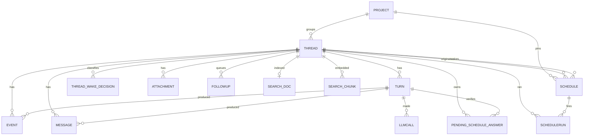

# Data model

Conversation data lives in one SQLite file; settings, phone-pairing keys and
private release receipts are separate files:

```
$ZWAI_HOME (default ~/.zwai-swarm)/zwai.db
```

Phone pairing keys are not in this database. `$ZWAI_HOME/remote/host_token` and
`$ZWAI_HOME/remote/identity` are 0600 files under the private remote directory.
`host_token` accepts a legacy raw token or a schema-1 JSON record containing
`token`, `origin`, `authorized`, optional `host_id`, `user_id` and `username`.
NOSEC requires a complete origin/account/host-bound authorized receipt; mode
selection itself is not authorization. The X25519 identity remains stable.
Reading legacy raw files is backward compatible in this client; downgrading to
an older client that only reads raw text cannot consume an activated schema-1
JSON receipt. Reconfigure with the older client or use the original private
raw-token backup for that Hub; the JSON document is not a raw token. See
[remote configuration](CONFIG.md#remote) for downgrade handling.
`pending-host-token-*` files contain private candidate token, origin, public key,
creation time and optional `proven_rejected` boolean (default false). They are synced before starting a login and retained after
cancel/uncertain failure so a successful server activation with a lost response
can be reconciled. An existing candidate reuses its file; at most 128 records of
16 KiB each are retained, and overflow refuses new candidates without removing
recovery proofs. A scope may have only one unresolved candidate. Normal retry
uses it before an older active receipt. Only a real current-attempt start `409`
marks it proven rejected; normal retry durably resets the flag before sending
it again, while explicit new-device recovery may stage a replacement first and
retire only proven-rejected records in that same scope. A network/cancel/lost
poll result remains unresolved. Successful activation and cleanup are serialized
under the Host lock and synced; foreign origin/public-key records are untouched.
A storage failure reports `credential_unavailable`. Device code and PKCE verifier live only in the
bounded Go login attempt, never SQLite, YAML, browser URL or renderer status.
Bindings (id, fingerprint,
session) live on the pairlink hub. The phone-reported model and last-seen
time live here in `remote_devices`, keyed by that fingerprint, so Settings
can name a bound phone after it has connected once.
A watched phone reads the same `EVENT` rows the desktop SSE does (clipped
bodies, same `kind`/`seq`); first paint is the last turn on one `ready`
snapshot (the `watch` RPC reply), older rows come from `log` paging. It does not get a second copy
of the timeline.

gorm owns the schema (`AutoMigrate` on every start) and
[`glebarez/sqlite`](https://github.com/glebarez/sqlite) is the driver, so there is
no cgo and no system SQLite to install. The file is opened with
`journal_mode=WAL`, `busy_timeout=5000` and `foreign_keys=1`: WAL is what keeps
the UI's reads from blocking behind a write-heavy streaming turn.

Phone preview and live-edge reads use `idx_turn_thread_seq` on
`turns(thread_id, seq)`, `idx_evt_thread_turn_seq` on
`events(thread_id, turn_id, seq)` and `idx_evt_thread_turn_kind_seq` on
`events(thread_id, turn_id, kind, seq)`. `store.Open` adds these indexes to
existing databases through the normal migration. No conversation fields or
stored event identities change. `internal/store/phone_reads_test.go` regresses
index recreation on reopen and actual query plans; previews project only the
fields they consume and paginate before decoding history.

One process owns the file — this is a desktop app — which is why sequence numbers
come from an in-memory counter per conversation, seeded from the table on first
use, instead of a `MAX(seq)` query per row. Events arrive once per streamed token;
a query each would be absurd.



## Read-only history SQL

`query_history` reads retained originals without a maintained summary table.
Its query connection does not migrate or write the source database. Call it
with `{}` to obtain current `schema: [{name, columns: [{name, type}]}]`,
canonical `field_semantics`, and
`context: {project_id, project_name, thread_id}`. Then pass one unqualified
SQLite SELECT/WITH in `sql`, with optional positional scalar `params`.
Success returns `ok`, ordered `columns`, complete object `rows` keyed by SQL
output labels, returned `row_count`, `truncated` and optional `reason`, plus
context. Errors return `ok:false` and `error:{code,message}` for correction.
The final JSON envelope is budgeted. Oversized rows are omitted whole, never
silently shortened; explicit substring paging is a caller-selected projection,
not a complete source. BLOB values retain JSON's base64 encoding.

A project conversation binds every available raw table to its actual project
before executing model SQL. `projects.id = threads.project_id`, then
`threads.id = messages/turns/events/attachments/llm_calls.thread_id`. A schedule
with a destination thread follows that thread; one without a destination uses
its own `project_id`. A run with its own thread follows that thread, otherwise
it inherits the job's destination. Origin/creation references do not confer
visibility. Predicates cannot escape this binding; missing bound projects fail.
Standalone conversations retain the global history view.

`messages` is the attributed transcript; `events` is the overlapping UI/runtime
timeline with worker/tool observations. `turns.status` is a recorded outcome,
not proof of every assistant assertion. `source=runtime` is not human input.
Retained compact/session-summary metadata is derived content, not independent
corroboration; report sources still resolve original message/event records.
Schema semantics distinguish table-wide `messages.id`, per-thread
`messages.seq`, the separate per-thread `events.seq`, and `events.message_id`
for a model output stream. They are not interchangeable. SQL aliases remain
caller labels, not base-table provenance or approval. SQLite's outer projection
disambiguates labels; unexpected duplicate metadata is refused without loss.
Archived threads remain readable; deleted/rewound rows do not reappear.

TEMP views exclude private restart checkpoints and mask non-history tables and
views, including admission payloads and unsent drafts. Reads use native
read-only, WAL-aware snapshots, never immutable mode or an incomplete copy of
the main file. The binding protects this SQL connection; it does not restrict
full-access filesystem or exec tools. See `C-036` in [CONTRACTS.md](CONTRACTS.md).

### Source-bound reports

The explicit turn input `history_report:true` is stored as an owned
`history_report_requested` event before model execution. A trusted manager or
worker read records `history_read_started` before SQL executes; its original
turn owner is supplied by the host, not arguments. This is a read-attempt
marker, not a successful query result or completion receipt, and it never by
itself selects the report protocol; only `history_report_requested` (directly
or through inherited Registry lineage) does.

`history_registry_inherited` reuses `events.source_turn_id` to record a
host-observed Registry/worker-state transfer within one conversation. The source
turn must precede its successor, and repeated identical edges are idempotent;
conflicting parents are refused. Indexed recursive lookup follows these edges
for read/request state. The worker retains its original turn owner, and a fresh
unrelated Registry does not inherit merely because an older turn read history.
Multiple restored worker owners are accepted only when the existing single-parent
lineage proves they belong to the same inherited Registry; an unrelated latest
turn is not an ownership fallback.
The edge is saved before runtime claim or restored worker installation; failure
cannot silently switch to an untracked owner. Edit/resend reads the old explicit
request marker before deletion and saves it on the replacement turn.

The model report is versioned JSON with only `version`, `language`, `sources`,
`proposals`, and `questions`. Each source binds a unique local key to
`{kind: message|event, thread_id, seq}`. Proposals carry plain-text title,
priority, disposition (`include|exclude|candidate`), proposal and local source
keys. There is no model-provided fact summary, quote, author, approval/status
or locator field. Empty source arrays are permitted for explicitly ungrounded
new suggestions.

The Store resolves those references to complete `HistorySource` records:
canonical reference, table row ID, thread title/project, actual role/source,
agent, full text, event kind/error, date and image references. Events have no
message-source column; their recorded role and event/agent identity are kept
separate from message authorship. The host displays full source bodies and
fixed suggestion groups, escapes model text, and states only the cited date
range/record count. Images are references, not a claim of image interpretation.
The final rendered output is rejected if it cannot fit without truncating a
source. Citation identity and fidelity do not prove semantic entailment,
current implementation or approval.

The existing private `pending_schedule_answers.payload` adds an optional typed
`history_report` containing request, `HistoryEvidence{project_id,sources}` and
rendered text; no curated summary is written. Pending recovery revalidates
canonical originals; the publication transaction compares recipient project
membership, full source identity/metadata/text/images and errors before
committing the public answer and accepted receipt. Missing, changed or moved
sources reject stale publication. Accepted reports keep their frozen rendered
bytes and original publication identity. Private payloads remain unavailable
to history SQL, SSE and ordinary replay.

## Durable composer snapshots (`F-145` / `C-033`)

`composer_drafts` stores one current snapshot per `draft_key` (primary key):
`revision`, `text`, JSON `quotes` and `files`, `state`, and `updated_at`.
`composer_draft_blobs` stores original binary `data`, with composite primary key
`(draft_key, file_id)`. File metadata retains its name, MIME, kind, byte count and
modification time. Browser object URLs and temporary upload paths are not stored.

A save compares the caller's revision inside the write transaction, verifies that
the owning thread/project still exists, inserts new immutable blobs, replaces
the manifest and removes unreferenced blobs. Any failure rolls back the whole
snapshot. Text-only edits reference existing bytes. Explicit clear and accepted
send use a new empty revision rather than deleting the row, so delayed writes
cannot resurrect a sent draft. Thread/project deletion removes its snapshots
and blobs in the same transaction as the owner. `new:home` is independent.

Snapshots are separate from sent `messages`, `attachments` and queued `followups`.
An unresolved `sending` state does not attest whether an HTTP request reached
the engine; reloading exposes it as uncertain and never automatically resends.
The first-send transition may temporarily retain identical source and target
snapshots until acknowledgment. That duplication protects against interruption
between creating a conversation and selecting it in the native window.

Implementation: `internal/store/composer_draft.go`; persistence, concurrent-page,
tombstone and rollback tests: `internal/store/composer_draft_test.go`.

## `projects` — a directory, an instruction and a memory

A project is the thing several conversations have in common. Its memory is not
in this database: notes and skills are files, so a person can read and fix them
(see [on disk](#on-disk)).

| column | type | notes |
|---|---|---|
| `id` | text, PK | `pj_` + 8 random bytes hex. **Also a directory name**, so it stays free of separators |
| `name` | text | what the sidebar shows |
| `system_prompt` | text | added to the manager's prompt for every conversation in the project |
| `workdir` | text | the directory the user chose; empty means zwai manages one |
| `memory_enabled` | bool | whether this project remembers anything. `memory.enabled` in the config can override it off, never on |
| `sort_rank` | int | sidebar drag order. `0` means never dragged: those rows interleave by `updated_at` with ranked rows |
| `created_at`, `updated_at` | time | gorm-managed. `updated_at` is also bumped when a conversation in the project is used, so the default project list is last used, not created |

## `threads` — one conversation

| column | type | notes |
|---|---|---|
| `id` | text, PK | `th_` + 8 random bytes hex. **Also the workspace directory name**, so it must stay free of separators and shell metacharacters. |
| `title` | text | placeholder from the first message, then a generated name from that opening line when the user did not supply one |
| `title_auto` | bool | true while the engine still owns the title. A user rename or a landed generated name clears it so a later namer cannot overwrite the sidebar |
| `project_id` | text, indexed | the project this conversation belongs to; empty for a standalone one. It decides where the tools work and what the prompt carries. Empty lists the shared skill library (`library/skills/`) in the prompt and reviews new procedures into that library |
| `provider_id` | text | which configured provider this conversation uses |
| `model` | text | the name this conversation sends; empty follows the provider's default so a Settings change applies until someone picks in the composer |
| `reasoning_effort` | text | this conversation's thinking level (``, `low`, `medium`, `high`); empty means the model's own default. Switchable in the composer, applied from the next turn |
| `goal` | text | standing objective from `/goal`. Empty means none. Injected into later turns until changed or cleared |
| `goal_complete` | bool | true after successful `complete_goal`. Completion fields and the `goal_complete` event commit atomically. A scheduled tool call whose own manager-created thread wake remains active returns `goal_schedule_conflict` without changing either. The text and completion state stay stored while PC/phone hide the completed goal strip; auto-continue stops and history remains. `reopen_goal`, `goal_resume: true`, or the `resume_goal` RPC clears completion, resets `goal_auto_turns`, and pursuit continues |
| `goal_blocked` | bool | true after `block_goal`, or after a pursuing turn has a non-recoverable failure outside the isolated scheduled-check boundary. Ordinary scheduled model/evidence failures do not set this field. Auto-continue stops until an explicit human resume; ordinary sends answer only that message and retain the pause |
| `goal_block_reason` | text | optional one-line reason from `block_goal`, or the public turn error when a pursuing turn dies before the manager can call it |
| `goal_started_at` | time | when the current objective was set (not edited). Nil when there is no goal |
| `goal_auto_turns` | int | consecutive runtime-started turns that kept pursuing an open goal. A human message resets it only while the goal is pursuing and not paused. Paused human sends retain it; explicit **Start** / resume or a valid `reopen_goal` resets it |
| `goal_capped` | bool | true after `goal_auto_turns` hit `swarm.goal_max_auto_turns`, or after the human interrupts a pursuing turn. Only an explicit goal resume clears this pause and resets its budget; ordinary sends retain both |
| `goal_idle` | bool | true after an engine-started continuation finished with no counted tool activity. Auto-continue stops until an explicit goal resume; ordinary sends retain the hold |
| `plan_mode` | bool | true while `/plan` is open. Write/edit/exec and similar are unmounted; `ask_user` and `propose_plan` stay |
| `plan_markdown` | text | current plan body. The file `$ZWAI_HOME/plans/<thread_id>/PLAN.md` is the on-disk copy; this column is what GET returns |
| `compact_summary` | text | briefing that replaces earlier replay in the next turn's prompt. Empty means no fold yet. Copied from `session_memory` when that is set and accepted. A transcript dump is not stored, and a previously stored dump is omitted from the next manager prompt |
| `compact_through_seq` | int64 | last **message** seq included in that briefing. Replay skips `seq <=` this when a summary is set |
| `session_memory` | text | rolling briefing of this conversation, updated from the event log at token/tool breakpoints (newest events that fit a rune cap). Compact copies it; successful-turn review may read it, while failed-turn requirements-only review excludes it. Empty until the first accepted refresh. Post-turn refresh is background work and does not block the next follow-up |
| `session_memory_through_seq` | int64 | last **event** seq included in that briefing. Advanced only on an accepted refresh. A rewind that deletes that event clears the three session-memory columns |
| `session_memory_tokens` | int | estimated event-log tokens at the last refresh attempt (accepted or failed), so the next gate knows how far the window has grown and a failed refresh cannot resend the same payload |
| `completed_seq` | int64, default 0 | latest eligible primary terminal event; quiet, cancelled and worker terminals do not add completion attention |
| `read_completed_seq` | int64, default 0 | observed completion acknowledged by a visible client; never advances beyond the supplied event |
| `terminal_seq_high_water` | int64, default 0 | persisted primary-terminal identity floor; retained across rewind so restart cannot reuse an old ACK's event number |
| `task_message_through_seq` (not null, default 0 for existing conversations) | int64 | monotonic default peer-inbox read cursor; not acknowledgement; explicit `after_seq` may reread older events |
| `archived` | bool | hidden from the sidebar's default list |
| `pinned` | bool | tracked in the sidebar Pinned section |
| `pinned_at` | time | when it was pinned; nil when it is not. Newest pin sits at the top |
| `sort_rank` | int | drag order inside Recents or one project. `0` means never dragged: those rows interleave by `last_active_at` with ranked rows |
| `created_at` | time | |
| `updated_at` | time | gorm-managed |
| `last_active_at` | time, indexed | bumped when a turn starts and when it ends. Unranked rows in a group sort by this |

## `messages` — the transcript the model sees

The conversation as the **model** reads it, replayed into the next turn. Tool
calls and tool results are kept verbatim rather than summarized, because a model
that sees a truncated tool result will re-run the tool.

| column | notes |
|---|---|
| `id` | auto increment |
| `thread_id`, `turn_id` | which conversation and which turn produced it |
| `seq` | per-conversation, increasing, `(thread_id, seq)` indexed; the read order. Refused or rolled-back admission may leave unused numbers |
| `role` | `user`, `assistant`, `tool`, `system` |
| `agent_id` | `manager` or a sub-agent id |
| `content` | the text |
| `source` | input provenance: `human`, `runtime`, `schedule`, or `plan`; empty on legacy rows and roles without input provenance. Runtime corrections stay in same-turn execution/diagnostics but are excluded from future replay and compact inputs |
| `reasoning` | the model's thinking, when the endpoint returns it separately |
| `tool_calls` | JSON array, exactly as received |
| `tool_call_id` | set on a tool result, matching the call |
| `images` | JSON array of `{id,name,mime}` for pasted vision input. The pixels live under `$ZWAI_HOME/inputs/<thread_id>/<id>`, not in this row |
| `event_seq` | timeline seq of the `steer` that minted this `[steer]` user row. Retract (`DELETE …/steers/:seq`) deletes by this column so two identical captions do not collide. Empty on every other role |

Legacy unmarked user rows equal to known runtime cue constants (including the exact worker-ID suffix) are excluded unless a matching durable human `user_message` / `steer`, or a nonautomatic turn input, proves human origin. Initial-input proof binds only the first user row of its turn, not later runtime duplicates with the same text. A marked human quotation is always preserved. This is read-time compatibility; historical rows and Trace are not deleted. The in-flight ADK message carries the same provenance in `Extra["zwai_message_source"]`. Goal continuation events are omitted from session briefing extraction; genuine human quotes remain input.

Replay into a later turn is **reduced** to user and assistant messages: the full
tool trace is here for troubleshooting, but feeding all of it back would blow up
the context on a long conversation. Manager answers are written here **as each
`agent_message` lands**, not only when the turn ends — otherwise a force-quit
leaves the UI with a conversation the next model call cannot see. Replay also
folds manager `agent_message` events that never got a row (older crashes) and
writes them into this table so the next force-quit does not depend on the
event scan. An answer already stored for that turn — including below
`compact_through_seq` — is not rewritten; that would mint a new seq and
undo `/compact`.
Candidate manager prose is withheld while scheduling-success claims are
checked. Admission rechecks the matched schedules and the running turn in one
transaction, then writes its `agent_message` events and assistant replay rows
together before broadcasting. A cancelled/retargeted schedule or ended turn
cannot admit a late success answer. `schedule_report` findings pass the same
fact check; admitting a report does not create an assistant replay message.
Unadmitted prose is excluded from compaction inputs. The interpretation call
is attributed to `schedule-answer-policy`; a bounded correction uses the
existing `model_retry` event with `reason: "schedule_claim_unverified"`.
Classifier service failures instead use the private candidate and backoff
state below; they do not consume that correction (`C-009`, `C-012`).


普通回合的 worker 收取状态也不新增表或列。生命周期工具的成功回执在既有
`tool_result.text` 中保存精确 `agent_id` 与 worker 执行 `generation`；manager
的配对 `wait_agents` 终态条目及成功 `close_agent` 决定该 generation 已收取或
明确放弃，wait 超时、unknown、孤立／异 caller／旧 generation 回执不结清。
提前完成的主管候选正文同样不能进入保存回答、压缩输入或后续模型输入。
原 turn 的 manager `model_retry` 事件保存
`{attempt:1,cap:1,reason:"workers_uncollected",worker_ids:[...]}`；消费一次纠正后
再提前结束，保留 running turn 和原 worker，写入 `max_iterations` 的
`reason:workers_uncollected`、`wait_id`、`workers` generation 集合与
`automatic_resume`。仅全为已知运行代、且本 turn 未消费自动唤醒时，等全部真实
终态后先写 `workers_collection_resumed` 再继续收取，每 turn 至多一次；该回执
不证明结果已收取、不重置纠正额度。身份变化或不可验证时保留人工等待。
重启 checkpoint 的 `pause:worker_collection` 保留原等待；恢复查询保留暂停与
自动唤醒回执，不能因进程更换重复授予。 人工拒绝在 ACK 前写入
`workers_collection_declined` 的精确等待身份；Stop 的持久意图优先于自动许可，
checkpoint 之后的新继续／唤醒／拒绝回执优先于旧暂停快照。 typed Continue 的
plain `max_iterations_continued` 与已消费的 `model_retry` 在同一非终态事件事务
提交后才 ACK、广播；第二条写失败不得留下只有续额的半个决定。live 与 cold
恢复使用相同已消费额度，不在下一模型请求前另留消费窗口。
`max_iterations_continued` 是授予一次新尝试的人类继续依据；重启读取相同事件
恢复额度，读写失败不得重置额度或授予新的请求（`C-019`、`C-027`）。
`/compact` is a second, optional fold: older
of those replay messages become a briefing on the thread (`compact_summary`),
copied from `session_memory` when that briefing exists;
events stay, so the transcript the human sees does not change. The same
columns are written mid-turn when a manager call would exceed
the compact trigger (after older replayable tool results are cleared). Compacted
answers are not unfolded from the event log, even when later messages of
the same turn are still live. Worker identity is **not** in this table: it
lives on `spawned` / `finished` events and their paired lifecycle tool receipts.
After a fold, a System runtime-worker roster supplies their IDs and current
states; historical workers are not fabricated assistant `spawn_agent` calls or
new creation receipts. The in-flight ReAct tail stays in ADK state; that is
not roster data.

Model generation lifecycle uses existing `events` rows, without another table.
`generation_started`, `generation_completed`, `generation_interrupted` and
`generation_recovered` retain `agent_id`, `message_id` and the original
`turn_id`. Interruption/recovery payloads retain `{reason,detail,recovery}`;
recovery updates are additional events, preserving the historical cause.
These are generation facts, not worker `finished` receipts or completion
attention. Legacy rows need no output-ID or cause migration.

## `pending_schedule_answers` — private admission and recovery state

| column | type | notes |
|---|---|---|
| `id` | text, PK | immutable candidate identity; report candidates bind the original turn and actual tool-call ID |
| `thread_id`, `turn_id` | text, separately indexed | owning conversation and running turn |
| `ordinal` | int64, unique with `turn_id` | assigned as that turn's `MAX(ordinal)+1` inside the save transaction. Determines insertion/recovery order; caller values, clock rollback and equal timestamps cannot change it |
| `kind` | text | `answer` or `report` |
| `payload` | text | latest answer's private versioned JSON while the turn is running; contains original answer ID, candidate text/events, Final/Transcript and max-iteration state. Reports retain their distinct committed-rearm IDs and original tool-call/result receipt. Cleared by the successful terminal transaction |
| `state` | text | `pending`, `deferred`, `accepted` or `rejected`; deferred releases candidate execution after the request-failure cap while retaining unpublished bytes. Terminal turns retain lightweight receipts, with pending/deferred changed to rejected |
| `created_at` | time | immutable wall-clock diagnostic; does not decide candidate order |
| `attempts` | int | persisted classifier recovery count, never decreased by a stale retry write |
| `classification_failures` | int | consecutive `classification_unavailable` request failures; invalid output resets it. Saved atomically with the retry time and deferred decision; local storage/configuration failures do not consume it |
| `retry_at` | time | next pending-candidate retry time; restart waits out the remaining delay. A deferred candidate is not retried |

Saving checks the owning thread, running turn and durable Stop receipt in the
same transaction. Reusing an ID cannot replace its owner, kind or payload and
does not reset its ordinal, decision or retry state. Reads include every state
ordered by the private ordinal, separate from public event sequence numbers.
Saving a new `answer` retains only its full transcript. Prior pending answers
become rejected lightweight receipts; prior deferred answers retain their text,
events and final while only the growing transcript is removed. Report payloads
and other turns remain unchanged. Insertion and this cleanup share
one transaction, so failure preserves the previously recoverable transcript.
This bounds retained full transcripts during a long turn instead of storing
every growing prefix; deferred private prose remains until terminal cleanup.
Private payloads are not events, Trace, SSE, search/replay messages or compaction inputs. Failed persistence
cannot be treated as a recoverable durable wait.

Admission checks current scheduling evidence and ownership again, then commits
public events, assistant replay messages and `accepted` in one transaction.
An empty public answer still commits its candidate decision. Repeating an
accepted ID returns `ErrScheduleAnswerAlreadyAdmitted` without another write
or broadcast; a batch mixing accepted and pending IDs is refused.
`FinishTurn` writes the terminal turn fields and clears every candidate payload
of that turn in the same transaction. Pending and deferred decisions become
rejected; accepted/rejected identity, creation time and retry diagnostics remain. A
failed terminal or cleanup write rolls back both changes and retains complete
payloads for recovery. This avoids retaining another full transcript for every
finished candidate; other turns' private data is untouched. Thread and
project deletion remove all candidate states transactionally. Rewind removes
the candidates of every deleted turn, including private payloads created
before the cut event in that same turn; late writes cannot recreate a deleted
owner. This table is independent of planned engine-handoff checkpoints. Three
consecutive request failures atomically move a pending candidate to deferred;
ordinary retry writes cannot revive it. Recovery does not use a deferred
candidate's older transcript in place of a newer checkpoint. For legacy rows
whose new counter is zero, the engine derives only a contiguous suffix of
candidate-bound `classification_unavailable` receipts ending at `attempts`;
invalid output, gaps or origin waits cannot establish more failures. The
recovered counter/deferral commits before further classification.
For reports, the schedule action commits before the separate private save.
An existing original-call receipt prevents repeating that action during
classification recovery. If the process dies before the private save, this
table cannot prove the action's outcome; recovery must verify current state.
The thread-level recovery read selects only nonempty report payloads, including
rejected decisions needed to identify original calls. It excludes full answer
transcripts and terminal receipts whose payload has already been cleared.

Implementation and transaction regressions: `internal/store/schedule_answer_pending.go`,
`internal/store/schedule_answer.go`, `internal/store/schedule_answer_pending_test.go`,
`internal/store/schedule_answer_deferred_test.go`.
Engine payload and recovery: `internal/engine/schedule_answer_pending.go`,
`internal/engine/schedule_answer_restore.go`.

## `turns` — one request and everything done to answer it

The `id` is the handle the whole troubleshooting story hangs off: the UI shows it,
`zwai trace <id>` replays it, `GET /api/trace/:turn` returns it.

| column | notes |
|---|---|
| `id` | `tn_` + hex |
| `thread_id` | |
| `seq` | per-conversation turn number |
| `status` | `running`, `done`, `error`, `cancelled` |
| `user_text` | what was asked. On `goal_continue` / `schedule_continue` this is the protocol prompt the model saw, not a human send |
| `final` | the manager's final answer |
| `error` | why it failed, when it did |
| `provider_id`, `model` | what actually ran, not what is configured now — settings change |
| `reasoning_effort` | the thinking level this turn ran with, so a trace shows what produced the answer |
| `goal_continue` | true when the runtime started this turn to keep pursuing an open `/goal`. The timeline records `goal_continued`, not `user_message` |
| `schedule_run_id` | set when this turn is a scheduled fire; empty for every other origin. Trace joins the run through it |
| `quiet` | true when a scheduled turn had nothing to report. The row stays for `zwai trace`; the transcript hides the bubbles |
| `schedule_continue` | true when the engine started this turn because a schedule fired. The timeline records `schedule_fired`, not `user_message` |
| `started_at`, `ended_at`, `duration_ms` | `ended_at` is null while running |

A turn stays `running` until it finishes, errors, or the user stops it. A
  crash, a kill, or quitting the app leaves the row running; the next start
calls `ResumeOrphanedTurns` and continues every leftover on the same turn id
(`resumed` on the timeline), replaying manager answers already stored on
`messages` or still only on the event log, and restarting sub-agents that
had `spawned` without `finished` under the same `agent_id`. An in-flight
`exec` (or any non-wait tool) with no `tool_result` is closed on that
timeline before `resumed` (`err` is `the previous process stopped`) so a
killed process does not leave the call looking live. A dangling
`wait_agents` is closed as a timed-out wait snapshot of those ids, not as a
stopped exec, so the manager can wait again on the live workers. Follow-ups in
`followups` stay queued during restart until that resumed leftover turn completes
or fails. Unread
`[steer]` rows stay on the leftover turn unless they were retracted
(`steer_retracted` plus `DeleteMessageByEventSeq`). An edit before the
manager reads one rewrites that message's `content` and appends
`steer_revised` (`{"seq","text"}`); the original `steer` event stays.
A user **Stop** is
`cancelled` and is not resumed. Two running leftovers on one conversation
keep the later one; a leftover `schedule_continue` that resume cannot
restart (no request, missing provider, gone conversation) or that is
dropped as superseded closes the bound `schedule_runs` row as `error`
so `HasRunningRun` cannot stick. `MarkStaleTurnsCancelled` still exists as a bulk
wipe; startup does not call it.

## `events` — the UI timeline

What the front end renders and replays. One row per durable event, including
cumulative checkpoints of a worker output that outlives a manager turn.
`GET /api/threads/:id/log` reads this table from the newest seq backward so
opening a conversation does not replay the whole log; `?since=` on the event
stream still walks forward.

| column | notes |
|---|---|
| `id` | auto increment |
| `thread_id` | |
| `turn_id` | groups a turn's events for the trace view and the turn footers |
| `completion` | bool, default false, internal only | eligible primary terminal whose event and thread watermark commit atomically; not exposed as a new wire event kind. quiet removes only that turn's eligibility |
| `seq` | per-conversation, assigned upward even after a rewind, `(thread_id, seq)` indexed. The SSE `id`, and what `?since=`/`Last-Event-ID` resume from. Editing a `user_message` deletes that row and everything after it, so this column can have a gap; the next event is still larger than the previous high-water mark |
| `kind` | see the [event table in the API docs](API.md#event-stream) |
| `source_thread_id`, `source_turn_id` | optional runtime-bound origin of a `task_message`; old events omit these columns |
| `agent_id` | `manager` or a sub-agent |
| `role` | for `spawned`, the sub-agent's role |
| `text` | the payload. For `spawned` this is the worker's system prompt (host snapshot plus the task). Older rows stored the role name here; `role` is the reliable role field. For `tool_result` this is the tool's stdout with newlines kept (clipped at 64k runes), not a one-line summary |
| `tool_call_id` | pairs `tool_call` with `tool_result` (and live `tool_delta`); agents issue several at once and they finish out of order |
| `message_id` | optional identity of one streamed model output. Worker checkpoints across manager turns retain it; a new model round or restored stream gets another identity. Legacy rows remain empty. It does not replace event seq or tool-call identity |
| `err` | set on `error` and on a failed `finished` |
| `images` | JSON array of `{id,name,mime}` on `user_message` and `steer` when the send carried pasted images. Never the pixels |
| `created_at` | UTC; the timeline offsets are computed against the turn's `started_at` |

`model_backoff` remains an event-text JSON envelope, with no new event column.
Origin observations contain `{scope:"origin",cooldown_id,attempt,wait_ms}` on
the actual turn/caller. The opaque process-local cooldown ID is shared by all
roles in that service generation and contains no endpoint. `wait_ms` is the
observed remaining delay, or `0` for an active probe with unknown remaining
time; a later failure can extend it. Chat and replay show one timed notice per
conversation/generation and omit zero-delay probe notices; Trace keeps each
caller record. This event grants no retry allowance and is not an LLM request.

Candidate recovery contains `{scope:"schedule_answer",attempt,wait_ms,code,
candidate_id}`. Codes are `classification_unavailable`, `classification_invalid`
and `classification_deferred` (with `wait_ms:0` at the cap). Candidate attempts
are independent of origin generations. Classifier calls bypass the origin gate
and implicit HTTP reconnect entirely. These events contain identity/decision
metadata, never the private candidate payload. Older events may omit scope or
cooldown_id; a candidate_id still identifies legacy candidate recovery.

`workers_retained` is an additive event kind using the existing `events.text`
JSON payload, without a schema migration or new column:

```json
{"reason":"scheduled_check_failed","owner_kind":"thread_wake","owner_id":"sch_example","worker_ids":["worker-1"]}
```

`owner_kind` is `goal` (thread ID) or `thread_wake` (schedule ID). The manager
records the exact still-running worker IDs durably before the scheduled
turn's terminal `error`. The turn/run retain their errors and unread result;
this receipt is neither successful execution evidence nor a spawn. A failed
receipt write cannot grant retention. Restoring a latest failed scheduled turn
requires this explicit receipt, a checkpoint and currently valid task
ownership; Stop/cleanup and checkpoint pauses revoke restoration. Legacy error
rows without a receipt are not rewritten or inferred to own live workers.
See `C-009`, `C-027` and the [event stream](API.md#event-stream).

`spawned`, `finished` and `cleanup` establish worker creation and terminal
state. `workers_retained` records explicit task ownership across a failed
scheduled check, while manager `error` completes the corresponding lifecycle
projection. Auto-compact re-injects the worker IDs and current states into the
next Generate after a fold. Do not treat
`messages` as the source of truth for who is alive. The live-edge log
page (`GET /api/threads/:id/log`) sends those rows as `roster` when they
are no longer in the viewport, so the Agents tab can be rebuilt without
walking the whole tool log. The client applies sidecar rows only to lifecycle state, without inserting
"Started" rows, historical error bubbles or turn dividers into the manager
transcript. Clicking a worker loads
`GET /api/threads/:id/agents/:agent/log` (that `agent_id` only).

**Streaming deltas are deliberately not stored.** `delta`, `reasoning_delta` and
`tool_delta` carry the full text so far, so storing each would store the answer
(or the command output) once per chunk. They are broadcast live with `seq = 0`;
the engine stores the completed block when it settles. `tool_delta` is keyed by
`tool_call_id` so two parallel `exec` calls keep their own snapshots. That is
why a refresh mid-turn shows completed thoughts and the answer so far, without a
hundred rows per paragraph — and why a reconnect never resumes mid-`exec` output.

**Progress pulses are not stored either.** A `progress` event restates what the
`spawned`, `tool_call` and `finished` rows already record, so a trace loses
nothing by their absence — while storing one every few seconds would add
hundreds of rows per turn that no replay needs. They too are broadcast with
`seq = 0`.

**Usage pulses are not stored either.** A `usage` event is the composer meter
restating `llm_calls`. The numbers already live on that table; storing a copy
per call would double it. Broadcast with `seq = 0`. Reload rebuilds the snapshot
from the table. The ring is the last **manager** prompt versus the selected
model's window — counting workers would make the meter jump to a number that is
not this conversation.

**`rewound` is stored.** After an edit-and-resend truncates the tables
(`events`, `messages`, `turns`, `llm_calls`, `followups`), the engine appends
one `rewound` row (`turn_id` empty, agent `manager`, `text` = the first removed
seq) under the same record lock, then broadcasts it. Its seq is above every
removed row, so a reader that lagged or reconnected receives it on catch-up,
and a reopened store seeds its counter above the seqs readers may still hold
as their cursor. A row a later rewind removes goes with it. Folding a history
page treats it as already applied. If that append fails, the marker is still
broadcast with `seq = 0`.

## `llm_calls` — where the time went

One row per model request. Sizes and durations, **not** prompts: enough to explain
a slow or failed turn without turning the database into a transcript archive.
Admission waits and cancellation before sending create no row. Request duration
starts after admission; the adapter's internal reconnect remains inside that
same call, including its separately traced backoff. A truncated streamed response
records a model error and keeps any usage already received; its EOF cannot clear
the shared service failure. See `C-029`.

| column | notes |
|---|---|
| `thread_id`, `turn_id`, `agent_id` | who made the call |
| `provider_id`, `model` | against what |
| `input_msgs` | how many messages were sent — the number that grows on a long conversation |
| `input_chars`, `output_chars` | request and response size |
| `prompt_tokens`, `completion_tokens`, `total_tokens` | billed usage from the endpoint. Zero means it did not say; the UI must not invent a tokenizer |
| `cached_tokens`, `reasoning_tokens` | prompt-cache hits and thinking tokens, when the endpoint reports them |
| `duration_ms` | wall clock |
| `err` | the endpoint's error, when there was one |

## `attachments` — what the human uploaded

| column | notes |
|---|---|
| `thread_id`, `turn_id` | `turn_id` is empty for files uploaded between turns (the Files panel). A composer send that attaches those files to the message writes the turn id so a later request can tell this send's files from leftovers |
| `name` | the original file name |
| `rel_path` | workspace-relative, always under `uploads/` |
| `size` | bytes |

This table exists so the Files panel can separate "what I gave it" from "what it
produced" — the workspace itself does not record provenance. A name that already
exists is saved alongside the old one rather than overwriting it.

## `followups` — messages waiting for the current turn

Typed while a turn is already running. They are **not** steering: the manager
does not see them until this turn completes or fails and the engine starts the
oldest one as the next turn. The live turn's user text is not stored as a
follow-up. Submitting an edit of a waiting row assigns a
new `seq` at the back of that FIFO. **Steer** on a row (or ⌘Enter on a new draft)
pulls that text into the current turn at the next model boundary instead and
drops a queued copy of the same words.
**Interrupt** on the unread-steer pin aborts the current manager tool so those
steers drain on this turn; **Delete** retracts one unread `steer` (event stays,
the `[steer]` message is dropped).
Cancelled turns leave the queue alone; an error starts the next queued human
message without changing the failed turn or schedule run. A crash, a kill, or quitting
the app also leaves the rows: they are not in-memory, so the next start still
lists them and flushes them after the resumed leftover turn completes or fails.
Deleting the conversation
deletes leftover rows. A consumer owns delivery only after its DELETE affects one row.
Automatic dequeue reselects the FIFO head after losing that claim to another
consumer or a concurrent edit; reading a row alone does not authorize delivery.
No consumed-row tombstone is stored, so a missing row does not prove whether it
was sent or removed by a person.

| column | notes |
|---|---|
| `id` | `fu_` + hex |
| `thread_id` | indexed |
| `seq` | per-conversation FIFO; an unshift after a lost `StartTurn` race uses a value in front of whatever is still waiting; submitting an edit assigns a new seq at the back |
| `text` | what will be sent |
| `created_at` | |

## `thread_wake_decisions` — human conversation-wait policy

The original effective human `user_message` and `steer` events supply authority
for a conversation's thread-wake policy. Unread-steer edits replace the text
being classified; retracted steers, peer messages and generated continuations
are excluded. The engine's read-only policy model caches `deny`, `allow` or
`unchanged` for each source. This is separate from `messages`,
`compact_summary` and `session_memory`: a source older than
`compact_through_seq` still governs the next arm after compaction or restart.

| column | notes |
|---|---|
| `thread_id`, `event_seq` | composite primary key. `event_seq` is the human timeline `events.seq`, **not** the model transcript's `messages.seq` |
| `event_id` | exact `events.id` that supplied the human message; prevents a rewound/reused sequence from inheriting another input's decision |
| `input_digest` | SHA-256 of the event kind, a NUL separator and effective human text. A revised source invalidates its old classification |
| `decision` | `deny`, `allow` or `unchanged`; callers cannot rewrite a cached decision for the same event identity and digest |
| `quote` | exact, nonempty substring of the effective human text for `deny` or `allow`; empty for `unchanged` |
| `created_at`, `updated_at` | gorm-managed |

The current policy is read from valid decisions in human-event order. The
latest explicit `deny` or `allow` decides; `unchanged` leaves it intact. Missing,
stale or invalid classifications are pending and refuse a manager thread-wake
write until classified. Stale rows are not authority. A later explicit human
`allow` releases a prohibition; a summary, manager, tool, skill or peer cannot.
Source text is read from the effective event, rather than copied into this
table. Classification runs lazily on a manager's thread-wake attempt, with at
most 16 uncached inputs per turn and a total 30-second verification deadline
including cancellable gate waiting. Successful cached decisions allow later
turns to continue backfill; a failed input is not requested again in the same
turn and remains pending. Refused `schedule_wake` and thread `report_schedule(next_in_s)` leave the
entire schedule row unchanged and emit no armed event. Reports without
recadence, including `keep:false` cancellation, remain available; a refused
recadence does not partially cancel the wait.

Implementation: `internal/store/wake_policy.go`. Existing human schedule-inbox
operations and `schedule_task` restrictions retain their behavior; there is no
new HTTP policy mutation endpoint.

## `schedules` — a wall-clock wait

A schedule is either a **thread wake** (lands on an existing conversation) or a
**standalone** job (mints a new conversation per fire). `next_run_at` is stored
UTC. Cadence columns (`delay_s`, `every_s`, `cron`) are persisted as given; the
engine enforces that exactly one is set.

| column | notes |
|---|---|
| `id` | `sch_` + 8 random bytes hex. Filesystem-safe, same family as thread ids |
| `kind` | `thread` or `standalone`. An inbox PATCH on an active or paused row may change it; `origin_thread_id` stays |
| `origin_thread_id` | conversation that created it. Standalone fires do **not** reuse it. A destination edit does not rewrite it |
| `thread_id` | wakes only: the conversation to wake. Empty on standalone rows. Later fires use the value after a destination edit |
| `project_id` | standalone workspace; empty means that fire gets its own directory. Cleared when the row becomes a thread wake |
| `provider_id`, `model`, `reasoning_effort` | standalone; wakes use the target conversation's model |
| `title`, `prompt` | display name + durable per-run instruction (user text). `title` may start as a truncated prompt |
| `title_auto` | true while the engine still owns the inbox label. A PATCH/tool title or a landed generated name clears it so a later namer cannot overwrite the list |
| `delay_s`, `every_s`, `cron` | one-shot delay, interval, or 5-field cron. Engine layer |
| `status` | `active`, `paused`, `done`, `cancelled`. Claim marks a delay `done`. `report_schedule` `next_in_s` may flip `done` → `active` under the same cap as create/resume; cancelled and paused stay dead |
| `next_run_at`, `last_run_at` | UTC. Due = `status=active` AND `next_run_at <= now` |
| `run_count`, `max_runs`, `until_at` | `0` / null means until cancelled |
| `created_by` | `human` or `manager` |
| `armed_turn_id` | exact manager tool turn that last armed this thread wake, written in the same transaction as its create/replace/recadence. Initially empty for untouched legacy rows and public/human creates; a later manager tool arm records its turn without changing `created_by`. Goal completion filters manager-created thread wakes and uses this identity as well as the claimed run, so consuming a one-shot and creating a new wake ID cannot evade the same-turn conflict. Internal lifecycle metadata (`json:"-"`), not a client-supplied goal association; legacy rows are not heuristically backfilled |
| `created_at`, `updated_at` | |

Deleting a conversation **cancels** wakes whose `thread_id` is that
conversation. Standalone rows that only have `origin_thread_id` stay `active`.

`GET /api/threads/:id/schedules` does not add a column. It lists non-cancelled
`kind=thread` rows whose `thread_id` is that conversation, plus any schedule
with a `schedule_runs` row on that conversation whose run `kind` is
`standalone` (or empty while the schedule is still `standalone`). That second
set is what minted the conversation. `origin_thread_id` is not that link.
Deleting a project cancels those same targeted wakes **and** standalone rows
pinned to that `project_id`.

## `schedule_runs` — one fire (or a skipped tick)

| column | notes |
|---|---|
| `id` | `srun_` + hex |
| `schedule_id` | which schedule fired |
| `thread_id` | the conversation that ran: the wake target, or the conversation minted for a standalone fire. A later destination edit does not move it |
| `turn_id` | the turn that ran, when one started. Empty on a skip |
| `kind` | `thread` or `standalone` at claim time. Quiet archive uses this, not the schedule row after a destination edit. Empty on fires claimed before the column: those still follow the schedule row |
| `status` | `skipped_busy`, `running`, `findings`, `quiet`, `error` |
| `summary` | short findings text from a fire. The inbox does not paint it on live rows; **Open findings** opens the conversation. Empty on quiet |
| `unread` | true for `findings` and `error`. Quiet runs are not unread |
| `created_at`, `updated_at`, `ended_at` | `ended_at` is null while `running` |

## On disk

```
$ZWAI_HOME (default ~/.zwai-swarm)/
├── config.yaml                ui.locale / ui.font / ui.ui_font_size / ui.content_font / ui.font_size / ui.code_font / ui.code_font_size / ui.content_width / ui.transcript_mode / ui.palette
├── engine.lock                exclusive lease; the kernel drops it when the process dies
├── engine.json                pid, url, mock, started_at, version, exe_dev, exe_ino of the live engine
├── engine.log                 stderr of an engine a shell spawned
├── zwai.db
├── remote/                    private connection state (0700)
│   ├── identity               long-term X25519 identity (0600)
│   ├── host_token             legacy token or bound authorized receipt (0600)
│   └── pending-host-token-*   bounded retry candidates (0600)
├── inputs/
│   └── th_ab12…/              pasted images, named by `img_` id
├── workspaces/
│   └── th_ab12…/              a standalone conversation's own directory
├── plans/
│   └── th_ab12…/
│       └── PLAN.md            `/plan` draft; not in the workspace
├── library/                   procedures from conversations in no project
│   └── skills/
│       └── <skill-name>/
│           └── SKILL.md       same layout; MEMORY.md is unused
└── projects/
    └── pj_cd34…/
        ├── workspace/         only when the project has no workdir of its own
        └── memory/
            ├── MEMORY.md      notes, one per blank-line-separated paragraph
            └── skills/
                └── <skill-name>/   lowercase, digits and dashes only
                    └── SKILL.md
```

`engine.lock` is an `flock` held by the one process that may open
`zwai.db`. `engine.json` is rewritten atomically when that process starts
listening (`pid`, `url`, `mock`, `started_at`, `version`, `exe_dev`, `exe_ino`).
`version` is what `/api/meta` reports. `exe_dev` and `exe_ino` are the
executable file at start, so a rebuilt binary is not the process still
running. A dead pid or a missing
file means the next shell may take the lock. A live pid whose
`GET /api/meta` fails, or whose `data_dir` is not this directory, is left
alone. `mock` is part of the lease: a `--mock` client will not attach to a
non-mock engine.

The lock's busy/free state does not identify its holder. A launcher pending
error identifies its own still-running child only, with lease ownership
unconfirmed; that child may not have attempted acquisition yet. It is not an
additional persisted lease record or permission to attach without validated
metadata.

Each skill directory may also contain `usage.json` with `views` (int64) and
`last_viewed_at` (UTC RFC3339 timestamp; zero time means never viewed). Only a
successful agent `skill_view` increments it, under the Store lock with atomic
replacement. Missing or corrupt optional usage reads as zero; the next view
repairs it. Listing, HTTP reading and copying do not count as views. Merges
sum usage and preserve the latest view, deletion removes the directory, and
copies start at zero; updating a copy retains its own usage. If a source
deletion fails, the keeper retains usage no longer held by readable sources,
including a source whose files were partially removed, allowing an ordinary
failed merge to retry without double counting. Copy refuses an occupied
destination directory even when it contains only an orphaned usage sidecar. A simultaneous
restoration failure is returned with the deletion error; process interruption
is not a cross-directory transaction. This sidecar is
excluded from SKILL.md modification time and content-digest comparisons.

`MEMORY.md` and `SKILL.md` are plain files, written atomically through a
temporary file and a rename, so a crash mid-write leaves the old version rather
than half of the new one. `PLAN.md` is the `/plan` draft for that conversation:
app data, never a file in the user's workspace. `SKILL.md` follows the
[agentskills.io](https://agentskills.io) layout: YAML frontmatter with `name`
and `description`, then the procedure as markdown. A copy from another
project also stores `origin_project`, `origin_name`, and `origin_digest`
(the project, the skill name there, and the digest of the text at copy
time). `origin_project` may be `library`: that file came from the shared
skill library, which is a directory, not a `projects` row. Those three are not part of the procedure. The copy is its own file:
editing it does not change the source, and a later edit of the source does
not change the copy until `POST /api/projects/:id/skills/:name/pull`. A
rewrite or patch keeps the link. An unmodified copy keeps tracking the
original project, so copying that copy does not start following a project
that never changed the text. Agent writes to `MEMORY.md`
are also capped per paragraph (`memory.entry_max`); a create that collides with
an existing skill (same subject, shared name stem, or a copied procedure) is
refused; a note that restates a skill's summary or steps is refused. A pointer
that names an existing skill exactly without restating its body can remain in
notes; an unknown name does not grant this exception. The plain paragraph
format of `MEMORY.md` is unchanged. After a
successful turn, leftover families are folded into one `SKILL.md` under the
shared stem. A hand edit of those files does not fold until the next turn, or
until `POST /api/projects/:id/memory/tidy-skills` (stems fold first, then the
reviewer curates the live catalog; the response names what was merged, deleted,
created and patched). Hand-edits of notes and the
Memory panel still use the total `char_limit` only.

Automatic review notes use a private in-memory snapshot, not a second persisted
memory format. `NotesDraft` reuses agent Add/Replace/Remove checks, then compares
the baseline content revision under the shared store lock before one atomic
`MEMORY.md` replacement. A net-zero draft writes nothing; conflicts and storage
failures leave the official notes unchanged. Existing Markdown paragraphs and
human-authored notes remain readable without a migration or mandatory provenance
backfill. Direct external file writers do not participate in that in-process
lock.

Requested project tidy additionally moves existing content between notes and
skills. Promote requires body and source-note text to be equivalent after whitespace
normalization, with no extra steps or assertions; demote requires a short body without Markdown step markers and
a whitespace-equivalent note under both budgets. Text overlap alone cannot
authorize deleting source content. The destination is saved first, then the
source is removed; partial failure may leave duplicates. Actual partial writes
are create/add/delete changes; a completed move is promote/demote. A retry
reporting no change establishes the already-present final state, not historical
source provenance. Shared-library tidy and post-turn review do not move notes.

Skills keep immediate file writes, including merge/delete; they are not part of
the notes commit. A later refusal must not hide an earlier actual skill write.
The `events.text` JSON payload for `memory_review` has optional `evidence`
(target/action, optional skill name and source seqs), `refused`, `stop_reason`,
`attempt_count` and bounded `attempts`. Stopping reasons distinguish completion,
iteration exhaustion, missing successful proposal and runtime error. Attempts
retain only number, accepted/refused/error status and operation target/action/
source seqs (at most 32 attempts, 32 operations each and 16 seqs per operation).
Refusals retain a controlled reason/category, operation index, attempt number,
source seqs and safe capacity usage/excess fields. Full proposal counts may exceed
the retained metadata list. Rejected bodies, exact quotes, old note/skill names
and model-only `current_entries`/`matched` feedback are not added to these fields;
existing accepted evidence and committed-change previews keep their meaning.
Committed `changes` can additionally include `before`/`after` strings, with both
present for a complete snapshot and an empty side for creation/deletion. Net note
edits preserve full entry text, while skill create/patch/delete preserve available
raw `SKILL.md` text. Historical and merge/move changes may have previews only.
The snapshot belongs to that stored event and is not reconstructed from the
current file; rejected proposals still do not enter these committed-change fields.
Batch tool arguments are not recorded as a proposal transcript. Existing events
may omit the new fields and remain valid. No new SQLite columns, Markdown front
matter or event kind are introduced. See [Memory reviews](API.md#memory-reviews) and
[C-025](CONTRACTS.md#c-025-memory-review-evidence-and-commit).

**Memory lives here, never in your working directory.** A project pointed at a
repository must not leave files in it, and a memory that was in the repository
would arrive in a commit, a diff and a code review. `skill_view` reads this
tree only — the manager and sub-agents both have it. The manager and
post-turn reviewer can write under their tool boundaries; a user-requested
project tidy can additionally reclassify existing content. Workers cannot write. A `SKILL.md` already in the workspace is a
file; the agent `read`s it rather than opening it as a recorded skill.

## `search_docs` / `thread_fts` — keyword index

One row per conversation. Rebuilt from the title, standing goal and
user/assistant messages. Tool dumps stay out so JSON keys cannot drown hits.
`thread_fts` is an FTS5 trigram virtual table content-synced by triggers.
Creating it rebuilds from whatever `search_docs` already holds, so an upgrade
does not sit on an empty MATCH until the next title edit.
Queries shorter than three runes skip MATCH and use LIKE, so two-character CJK
still hits. Archived conversations are filtered at query time.

| column | notes |
|---|---|
| `id` | integer PK; FTS `content_rowid` |
| `thread_id` | unique, the conversation |
| `title` | sidebar name at index time |
| `body` | concatenated goal + messages, capped |

## `search_chunks` — optional embedding passages

Only filled when `search.embedding` is on and a model is named. One row per
passage per model. Vectors are little-endian float32. A pin change deletes
rows whose `model` is not the current name.

| column | notes |
|---|---|
| `id` | integer PK |
| `thread_id`, `chunk_key`, `model` | unique together. `chunk_key` is `title`, `goal`, or `msg:<id>` |
| `text_hash` | sha256 of the passage; unchanged text is not re-embedded |
| `dim` | vector length |
| `vector` | packed float32 |

## `remote_devices` — bound phone labels

The hub list is fingerprints. After a phone links, this PC stores the
model line it sent (`hello`) so Settings → Phone can show that instead
of hex. A quiet reconnect (no `hello` yet) updates `seen_at` and must
not wipe `label`.

| column | notes |
|---|---|
| `device_fp` | text, PK. pairlink fingerprint (16 hex chars) |
| `label` | the phone-reported one-line model, clipped to 80 runes |
| `seen_at` | last time this fingerprint opened a link |

## Lifecycle and retention

- **Delete a conversation** (`DELETE /api/threads/:id`): its messages, turns,
  events, model calls, attachments, follow-ups and search index (keyword doc
  plus embedding chunks) are removed in one transaction, then the
  row, then its workspace directory — **only when zwai created that directory** —
  and its `inputs/` folder and `$ZWAI_HOME/plans/<id>/`. Wakes whose `thread_id`
  is that conversation are cancelled in the same transaction; standalone
  schedules that only originated there stay. A conversation in a project shares the project's
  directory, which may be the user's own repository, so the workspace is left
  alone; pasted images still go because they never lived there. A turn,
  worker or post-turn review still running when the deletion commits cannot
  write rows back. `turns`, `events`, `messages`, `llm_calls`, `attachments`
  and `followups` each carry a `<table>_require_thread` `BEFORE INSERT`
  trigger that aborts a row whose nonempty `thread_id` names no conversation;
  the store reports it as `store.ErrNotFound`. An empty `thread_id` (a
  standalone schedule's namer call in `llm_calls`) is allowed.
  `llm_calls_require_turn` also refuses a model call whose nonempty `turn_id`
  is not a turn of that conversation, so a post-turn review finishing after
  an edit-and-resend cannot store a row under the removed turn. `store.Open`
  drops the triggers before `AutoMigrate` and creates them again after it,
  because SQLite validates triggers when a migration renames a rebuilt
  `threads` table into place.
- **Delete a project** (`DELETE /api/projects/:id`): its conversations' messages,
  turns, events, model calls, attachments and follow-ups are removed. Wakes
  whose `thread_id` is one of those conversations, and standalone schedules
  pinned to that `project_id`, are cancelled in the same transaction. Then the
  project row, then the directories zwai created for it — its managed workspace
  and its memory. A `workdir` the user supplied is never touched.
- **Nothing is pruned automatically.** Events are the only table that grows fast;
  if a database ever gets uncomfortable, delete old conversations.
- **Backup** is copying `~/.zwai-swarm` while the app is not running. The
  workspaces and the projects' memory are files, so a backup that skips them
  loses agent output and everything the projects learned.

## Reading it directly

```bash
sqlite3 ~/.zwai-swarm/zwai.db \
  "select id, status, duration_ms, substr(user_text,1,40) from turns order by started_at desc limit 5"
```

Prefer `zwai trace <turn-id>` — it joins the three tables you actually want and
formats the timeline. Reach for SQL when you need to look across conversations.

## Private TestFlight receipts (F-430 / C-010)

`$ZWAI_HOME/releases/<batch-version>.json` stores the frozen batch `version` and
`source_sha`; its `ios` object additionally records `marketing_version` and
`build_number`. The upload/publication rows in
`$ZWAI_HOME/ios-signing/testflight-releases.json` likewise keep iOS marketing
version separate from source batch version. Pending change rows receive
`delivered_marketing_version` alongside `delivered_version` (the source batch)
and `delivered_build_number` when testing availability is verified.

Legacy recovery state without `marketing_version` reads the retained IPA's
version first, then the matching source receipt's version (the batch version
for old receipts). A new candidate uses this app's highest-build successful
publication; old publication rows use `version` when no separate marketing
field exists. Observed public builds without a local version receipt obtain
their marketing version from Apple's `preReleaseVersion`. No SQLite migration
is required. Exact-build export-compliance records still use source SHA and
build number, with an optional source batch `version`; an iOS marketing-version
change does not authorize reusing another build's declaration. See
[release version and recovery rules](RELEASE.md#testflight-version-and-build-number).

Completion columns migrate as zero/false, so existing conversation history does
not suddenly appear unread. Rewind deletes events and recomputes the surviving
completion/read watermarks in the same transaction; the terminal identity floor
is retained when the event counter is reseeded after restart (`C-023`).

## Restart checkpoints (`C-027`)

No new table is needed. A version-1 `engine_restart_checkpoint` event belongs
to the original conversation/turn and stores `pause`, iteration-cap state and `cap_decision`, an accepted question
`answer`, `human_stopped`,
`manager_history`, `manager_inbox` and `workers`. Each worker records its
original `id` and `role`, current invocation `task`, original-task
`instruction`, structured `history`, unread
`inbox`, `timeout_failures`, actual `finished`/`result`/`err`, optional handoff
`summary`, and `in_flight` tools (`name`, `call_id`, `arguments`). After recovery,
`task` can be a resumption cue; the original assignment remains in `instruction`
and its retained conversation history. Before serialization, a copy of
`manager_history` removes prose marked as an unverified scheduling answer,
including raw Responses output text. Accepted history, tool calls and reasoning
remain. The original in-memory checkpoint is unchanged; candidate recovery
uses `pending_schedule_answers` instead of public checkpoint prose.

worker 还保留可选 `generation`、`collected` 与 `close_requested`，对应公开
checkpoint／restore 结构的 `Generation`、`Collected`、`CloseRequested`。
`generation` 绑定一次 worker 执行，resume 开始新值，区别于一次模型输出的
`message_id`。`collected` 表示真实终态结果已交给 manager，或 manager 明确
关闭已结束任务而放弃结果；`close_requested` 表示对该 generation 请求取消。
二者不伪造 worker 成功，不覆盖已观察的失败。运行与已完成未收取的结果均保留
到结清，Stats／历史归档淘汰不能丢弃它们。缺 generation 身份的旧 finished
checkpoint／roster 按 legacy 已结束兼容，不追加追溯收取义务；旧 running 仍待
收取，新 `generation>0` 保留精确状态。冷回放只从同 manager 配对工具回执恢复，
不能凭旧 ID 或正文推断收取；人工 Continue 暂停仍由同一 checkpoint 保存。

The latest valid checkpoint supplies recovery state; confirmed lifecycle
events remain authoritative for subsequent completed work. Summaries are
separate from results. In-flight calls receive an explicit unconfirmed outcome
and retain their call identity rather than being automatically executed again.
Checkpoints do not create completion attention. The event stays in the normal
Trace and follows the existing data-directory permissions; streamed deltas
remain broadcast-only. See `internal/engine/restart.go`,
`internal/engine/resume_workers.go` and `handoff.go`.

`user_stop_requested` is a durable human stop intent, separate from a turn's
terminal event. Startup settles an unfinished turn that already has an
acknowledged Stop or authoritative terminal event without executing it again.
A completed manager turn can still own parked worker checkpoints;
`ResumeParkedWorkers` restores those workers directly without minting another
manager turn or moving its future wake. Active parked workers keep the engine
alive while a future wake with no execution does not.

### Cloud built-in tool receipts

Provider `api_mode` and `builtin_tools` live in `config.yaml`; no new database
schema is needed. Existing events store `kind=builtin_tool` and a JSON `text`
receipt with cloud ID/type/status/action/details, provider/model and `llm_call_id`.
`details` retains the actual cloud output item returned by the provider.
Event turn/agent identity remains the one-ID troubleshooting key. These rows do
not create local tool results or worker lifecycle events (`C-030`).

### Startup restoration diagnostics (`F-110`, `C-027`)

The existing event table stores `engine_restore` on the original thread and turn.
Its JSON records recovery phase, `duration_ms`, `scanned_events` and
`checkpoint_reads`; it is diagnostic metadata, not a worker completion or spawn.
Recovery queries reuse `idx_evt_thread_kind_seq` and read the latest valid v1
checkpoint plus the selected lifecycle and pending-tool evidence once per
conversation. No new table, migration, archive or event-body compression is added.

### Mobile Gateway account state (`F-211`)

No PC database migration is required. Phone storage keeps the configured Gateway
origin, one Mobile session (`origin`, opaque credential, user/device IDs and
expiry) and at most one pending device authorization proof, separate from
personal providers. Pairlink saved links may carry `gatewayOrigin`,
`gatewayOwnerID`, `gatewayMobileID` and `gatewayHostID`; automatic reconnect
validates the exact current account/Mobile identity and reuses the saved ticket,
without issuing a new binding or undoing revocation. An explicit PC selection
issues a fresh ticket. Logout/revocation removes managed links while
preserving anonymous ones. The original private device identity stays local.
The existing bounded direct-thread store retains the exact `providerId`; Gateway
source IDs are account-qualified and transient provider projections never enter
`zwai.phone.providers`. Server conversation history is visible only for the
current validated bootstrap source ID; sign-out/another account hides it without
deleting it, and an approved same-account API-disabled session can still read
its own history. No private provider configuration is synchronized to the
Gateway. Local credentials retain the existing phone storage security boundary;
this change does not claim hardware-backed secure storage.
