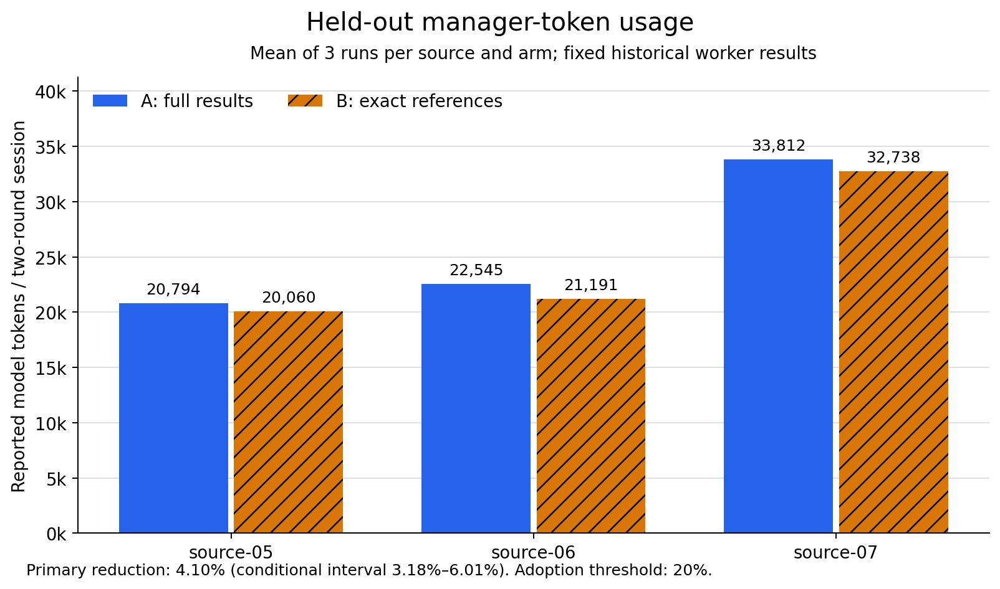

# Worker-result context references

Retain current product behavior. On the three held-out historical sources,
exact references reduced reported manager tokens by **4.10%**, below the
predeclared **20%** threshold. The candidate passed **9/15** complete-session
semantic reviews and still had **6 sessions with critical errors**. No product
prompt, provider adapter, worker, scheduler or notification behavior was changed.

| Measurement | A: full native results | B: same-request references |
| --- | ---: | ---: |
| Completed sessions / human rounds | 15 / 30 | 15 / 30 |
| Held-out reported tokens | 231,455 | 221,969 |
| Independent semantic session passes | 8/15 | 9/15 |
| Held-out semantic session passes | 5/9 | 6/9 |
| Large discovery-case semantic passes | 0/3 | 0/3 |
| Sessions with critical semantic errors | 7 | 6 |
| Prior stall-counterexample session passes | 3/3 | 3/3 |
| Median two-round session duration | 22.71 s | 24.52 s |
| Incomplete usage / harness errors / scope violations | 0 / 0 / 0 | 0 / 0 / 0 |



The prespecified source-level conditional 95% interval for token reduction is
**3.18%–6.01%**. It describes these three selected result sources, not a wider
task population. Averaging per-source percentages gives a different statistic;
the primary result is one minus the ratio of summed paired source means.
The complete [sanitized aggregate](context_reference_results.json) retains
per-session usage, timing and review outcomes.

The large discovery source saved **14.41%** of reported tokens, but none of its
six session outputs passed complete semantic review. Both arms could expand
two sampled observations into a claim covering four records, assert unsupported
relationships between tasks, confuse quantities from different historical
reports, or omit important exceptions and failure conditions. Correct worker
identity, required anchor mentions and reversible input representation did not
establish complete reasoning quality. A one-session difference in passes does
not establish a general quality improvement. Timing medians are descriptive;
no speed improvement or monetary saving was established.

All-case token reduction is **9.84%** (714,451 to 644,142), including discovery
and the constructed regression. It is not the primary held-out result. Neither
the efficiency nor the quality gate passed, so an actual-engine/full-catalog
prototype and product adoption were not started.

An independent integrity audit matched all 33 frozen hashes, all 30 sessions,
60 human rounds, 120 model-call receipts and 60 native waits. All required
worker identities were actually read in each round. Its 69 references expanded
back to 202,698 exact result characters with other metadata preserved. Native
tool receipts and Registry history remained full. All exit/credential-deletion
receipts passed; a separate process observation found zero matching live
helpers. Per-directory deletion identity was not independently re-observed.
This is Registry/ADK evidence, not durable database-replay acceptance.

The measured component base is `92423fb88c2751cf5ceec6dbdb0e297f34552850` with
the versioned experimental helper sources. Helper SHA-256 is
`d1348f1b75ee1dc58eb150bd4dc4b42761ef0df2563e9eff55a8bc635f64b97c`;
manifest SHA-256 is
`3ce3a515cfffa7968cd426ea878d46c347c1b505587a9bf4f92c6590bfb50c50`.
The configured model was `glm-5.3-flash`. Raw historical text, source maps,
answers, model inputs, original semantic reviews, frozen plans and independent
numeric/integrity receipts remain private outside Git.

This second experiment evaluates a narrow, lossless reference mechanism inspired
by the upstream context-reference design. It is not an implementation or test of
the complete upstream supervisor, router or subscription architecture.

The first [monitoring reminder trial](RESULTS.md) remains rejected. Current
manager/worker inboxes already drain accumulated messages, same-role workers
are reused, and retained project history is available on demand. An additional
router or persistent worker does not establish an incremental benefit by itself.

## Evidence and comparison

A bounded, read-only historical audit selected four discovery and four held-out
task sources before inspecting held-out bodies. It found two manager turns
requesting the same 82 worker IDs. Each retained Trace copy was clipped at
64,001 characters. The 23 complete recoverable entries contained identical
worker IDs, statuses, results and errors: 58,750 result characters plus 757
error characters. The old records lacked generation, so this does not establish
historical generation identity. Trace clipping also does **not** establish
model-input clipping: the native wait tool returns full results to the model.

The experiment uses those 23 discovery receipts and every complete finished
receipt from the original held-out sources: three sources supply seven receipts;
the fourth supplies none and is not replaced. Two receipts for the same historical
worker at different stages remain distinct records. Static replay IDs and
generation 1 identify the new fixture execution, independently of historical
IDs and recorded or missing generations. Necessary redactions preserve the
remaining text; private originals and replacement maps stay outside Git.

Arm A forwards full native `Registry.wait_agents` results through actual Eino
ADK and the configured provider. Arm B scans each complete outgoing request and
replaces only later, exact successful-result duplicates with references to the
first complete result still present in that request. Identity includes worker,
positive generation, role and a SHA-256 of the exact result/error strings.
New generations, changed results, failures and ambiguous inputs remain full.
All other report fields remain. Original tool receipts and Registry history
are not rewritten. There is no cross-request reference cache or external result
resource. Removing an earlier full message therefore prevents its reuse.

Both arms use the same minimal experimental tool catalog and neutral reference
protocol description. Only the real wait tool can run; other lifecycle actions
are refused and recorded, and file or shell tools are absent. Both arms receive
identical task instructions, worker texts, model and budgets. This controls the
input projection; it is not an untouched production-tool-catalog comparison.

## Frozen method

Each of four historical sources has two human rounds, with the second explicitly
requesting another native wait. A separate constructed regression retains the
previous 35-minute stall against its task's 30-minute threshold. Its original
decision truth is unchanged; this experiment uses actual wait receipts and a
nonempty final JSON reason instead of the old file-read/notification fields.
It does not test notification delivery. Three repetitions in each arm give
30 sessions and 60 manager rounds across five cases. Repetitions and the
constructed regression are not additional independent historical tasks.

Before real calls, freeze the helper binary, Go sources, orchestration and
analysis code, provider conditions excluding its secret, task/oracle files,
source mapping receipts and protocol amendments. Pair and counterbalance arm
order. Keep all failures; do not tune after observing primary outputs.

The primary screen compares mean complete model-call token usage within each
of the **three held-out sources**, then computes the paired ratio and a
10,000-resample source-level percentile interval (seed 20261102). A 20% token
reduction with a conditional 95% lower bound above zero is required. Every
candidate session must pass independent semantic review, with zero critical
errors, scope violations, incomplete usage or unverified cleanup. Exact session,
source, split and round coverage must match the frozen plan. The large discovery
case is diagnostic and cannot establish held-out improvement.

The three-source interval is conditional on this selected collection, not a
population estimate. Usage covers all model requests made by this manager
adapter; historical worker execution, HTTP-engine auxiliaries and production
operations are outside the measurement. Timing and cache fields are reported
separately. Total tokens are not a monetary bill, and persisted cache zeros do
not prove the upstream explicitly reported zero.

A passing screen requires a subsequent actual-engine/full-catalog comparison
and affected runtime regression before product adoption. The helper does not
accept HTTP scheduling, durable database replay, notification/quiet/unread,
native UI, Stop or process replacement. Those boundaries must be exercised if
an implementation affects them.

## Reproduction

Use the [Registry/ADK helper](../../tools/workercontext_eval/README.md) and a
private, sanitized fixture set with a separate oracle. Provider configuration
is read only. Evidence must be new and outside the repository.

```bash
go build -o /absolute/private/workercontext-eval ./tools/workercontext_eval
python3 tools/worker_context_trial.py --config /absolute/private/config.yaml \
  --provider <provider-id> --helper /absolute/private/workercontext-eval \
  --inputs /absolute/private/inputs --out /absolute/private/new-trial \
  --freeze-file /absolute/private/preregistration.json --plan-only
python3 tools/worker_context_trial.py --config /absolute/private/config.yaml \
  --provider <provider-id> --execute-plan /absolute/private/new-trial/manifest.json
python3 tools/worker_context_integrity.py --root /absolute/private/new-trial \
  --manifest-sha256 <independently-recorded-manifest-sha256>
python3 tools/worker_context_analysis.py /absolute/private/new-trial \
  --reviews /absolute/private/reviews.json
```

The inputs directory has `tasks.json`, `expectations.json` and one fixture per
case. Each task binds its source and discovery/held-out/regression split; the
model fixture contains only the shared instruction, rounds and whitelisted
worker fields. The hidden oracle never enters model input. Credentials use an
owned temporary directory removed after each exited helper. Durable evidence
files are explicitly `0600`, preserving the compiler and child umask.

Offline integrity tests cross real Registry → ADK → provider → final SDK HTTP
requests. They check full baseline bodies, exact resolvable references, unchanged
native receipts/history, malformed and ambiguous input refusal, changed
generations, cancellation and usage completeness. They do not establish
real-model quality or production cost improvement.
